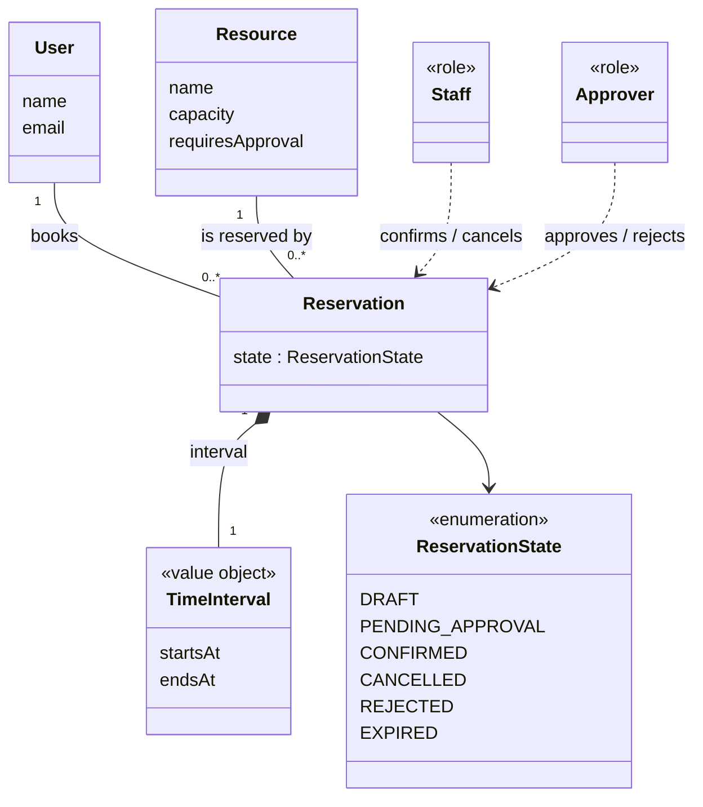
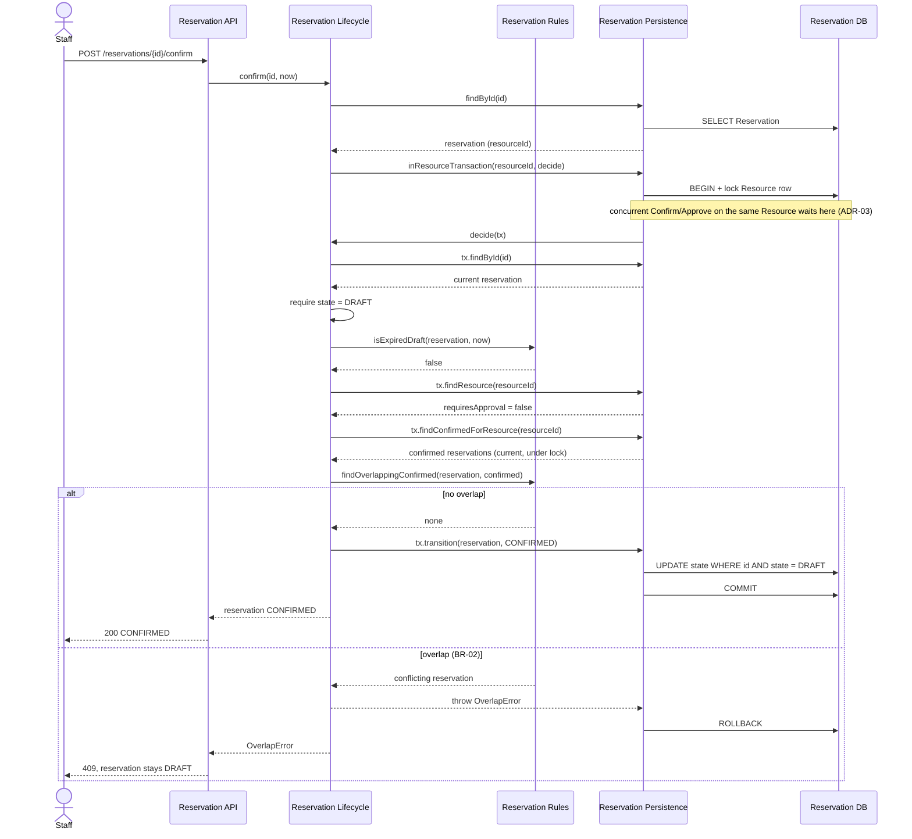
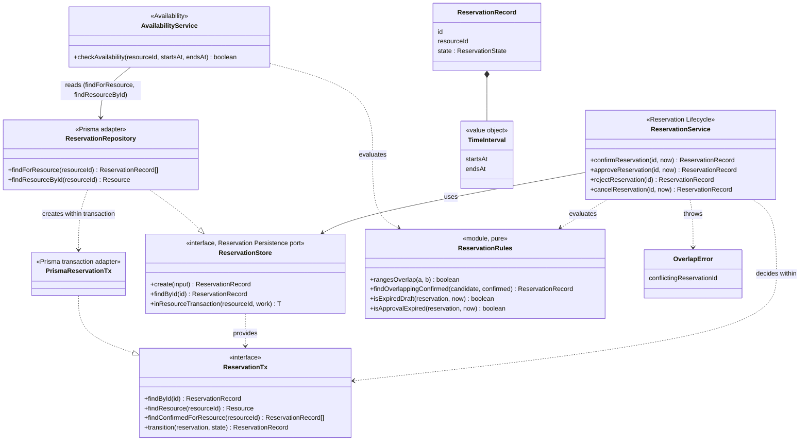
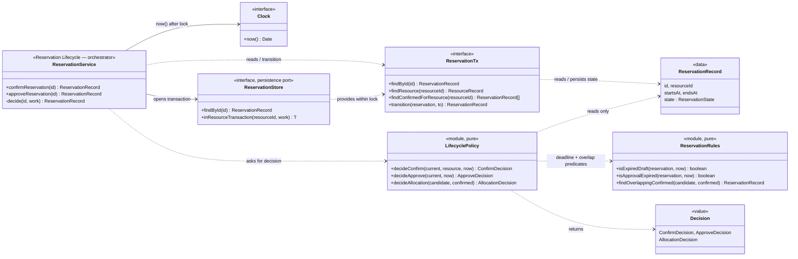

# Architecture & Decisions

## Tech stack

| Vrstva | Volba | Zdůvodnění |
|---|---|---|
| Jazyk | TypeScript (Node.js 20+) | Tým se rozhodl proti C#/Javě; TS dává statické typy a je pro tým nejznámější. |
| HTTP framework | Express | Nejrozšířenější, minimum boilerplate pro malé REST API. |
| Validace vstupu | Zod | Deklarativní validace + inference TS typů ze schémat. |
| ORM / DB přístup | Prisma | Typový bezpečný přístup k DB, snadné migrace, jeden zdroj pravdy (schema.prisma) pro model domény. |
| Databáze (aktuální dev / cíl) | PostgreSQL 16 | Výchozí `prisma/schema.prisma`, samostatná SQL migrace; lokálně připnutý embedded PostgreSQL 16.14 nebo Docker Compose. |
| Databáze (historický spike / regrese) | SQLite | `prisma/sqlite/schema.prisma` a původní migrace pro opakování C01/C02. |
| Testy | Vitest | Rychlé, nativní ESM/TS podpora, bez extra transpilační konfigurace. |

## ADR: SQLite pro C01 spike, PostgreSQL jako produkční cíl

> Historické rozhodnutí C01. Přechod je technicky dokončen 11. 10. 2026;
> aktuální setup a výsledky jsou v [technickém dokončení](c03-technical-completion.md).

**Kontext:** Zvolený tech stack (viz výše) počítá s PostgreSQL. Ve vývojovém prostředí, kde byl
prováděn C01 engineering spike, ale nebyl dostupný Docker ani lokální instalace PostgreSQL
(a nebylo možné je bez interakce nainstalovat).

**Rozhodnutí:** Spike A (persistence) byl proveden proti **SQLite** přes Prisma. `docker-compose.yml`
s PostgreSQL je připraven v repu pro každého, kdo má lokálně Docker.

**Důsledky:**
- Původní spike používal SQLite. Od 11. 10. je výchozí schéma PostgreSQL;
  SQLite schéma i migrační historie zůstávají samostatně v `prisma/sqlite/`.
  Import existujících lokálních dat provádí `npm run db:import-sqlite` se zálohou
  a kontrolou shody řádků. Migrace různých providerů se nemíchají.
- Doménová pravidla se změnou providera nemění. Garance souběhu v repository je ale
  závislá na izolačním chování databáze; od dokončení C02 nestačí pouze přepnout provider.
- Přechod byl požadován před CP1 (C03/C04); dokončení a opakovatelné ověření
  PostgreSQL jsou doloženy v aktuální evidenci.

## Future pressure: Q — Quality / Scale

Zvolená konkrétní pressure a zdůvodnění jsou zapsané v `docs/intent-and-change.md`
(sekce *Selected future pressure*) — shrnutí: 10× víc souběžných rezervací (páteční večer / velká
sportovní akce) zvyšuje riziko race condition v overlap-check při `confirm`. V C01 tuto pressure
**neimplementujeme**, jen ji evidujeme jako známé riziko pro pozdější iterace (kandidát na řešení:
DB transakce s `SELECT ... FOR UPDATE` / unique constraint na (resource, confirmed, no-overlap),
což u SQLite navíc není 1:1 přenositelné — další důvod pro včasný přechod na Postgres).

## ADR: atomické přechody v SQLite pro REQ-04 (22. 9. 2026)

> Historický mechanismus C02. C03 ADR-03 níže ho nahrazuje rozhodnutím
> v Lifecycle pod zámkem Resource; následující text zachovává původní evidenci.

**Problém:** samostatné čtení overlapu a následný bezpodmínečný zápis dovolovaly dvěma
Confirm/Approve alokovat stejný slot; staré čtení také mohlo přepsat Cancel/Reject.

**Rozhodnutí:** všechny rezervace mění stav přes `ReservationRepository.transition`.
Jeden podmíněný `updateMany` kontroluje ID a očekávaný stav; pro cílový CONFIRMED
navíc v témže UPDATE vyžaduje, aby neexistovala překrývající se CONFIRMED rezervace
stejného stolu. SQLite serializuje zápisy, takže následný zapisovatel vyhodnotí
predicate proti již zapsanému výsledku. Předchozí service overlap-check zůstává pro
konkrétní chybovou zprávu; bezpečnost nezávisí na jeho zastaralém výsledku.

Nulový počet změněných řádků je `ReservationConflictError` → HTTP 409. Dva Cancely
na výsledný CANCELLED vrátí stejný úspěch. Vrací se výsledek vlastního přechodu,
nikoli dodatečně načtený stav, který mezitím mohl změnit další příkaz.

**Ověření:** `tests/services/concurrency.test.ts` používá dva nezávislé Prisma
klienty a bariéru po čtení; oba požadavky prokazatelně pracují se starým stavem
před závodem. Pokrývá Confirm/Confirm, Approve/Approve, duplicate Approve,
Confirm/Cancel, Approve/Cancel, Approve/Reject, dvojí Cancel, dotyk intervalů a
smíšený Confirm/Approve. HTTP ověření je V-04R.8. Aktuální výstup je v
[evidenci dokončení](c02-completion-evidence.md).

**Rozsah garance:** aplikační příkazy na současném SQLite schématu. Přímé administrátorské
zápisy do DB ji mohou obejít. Pro PostgreSQL pod READ COMMITTED nelze ze stejného
dotazu odvodit stejnou garanci; před migrací zavést a ověřit např. serializaci podle
Resource či exclusion constraint pro intervaly, plus ochranu přechodů stavu.
Jednoduchý UNIQUE na identických začátcích/koncích libovolný překryv intervalů neřeší.

**C03 driver:** zachovat REQ-04 při změně DB a 10× zatížení; druhý driver je fyzická
expirace bez dalšího Approve a případná notifikace. Tyto mechanismy nejsou součástí
této změny. Nezavádí se globální mutex omezený na jeden proces.

## C03 Part A — AS-IS: Confirm Reservation

Mapování současné realizace jednoho scénáře z baseline v0.2. Tvrzení jsou ověřená
v kódu (commit `b4f597c`, branch `c03`), testy a za běhu aplikace dne 5. 10. 2026.
Řádky kódu odkazují na tento stav.

> **AS-IS zůstává AS-IS:** Část A popisuje kód **před** změnou C03 K (commit `c2c9a7d`).
> Odkazy na řádky v A2–A7 platí pro commit `b4f597c`. Současný stav popisují G2, H1, H2 a K.

### A1. Sledovaný scénář

| Položka | Hodnota |
|---|---|
| Scénář / operace | [OP-03 Confirm Reservation](specification.md#op-03--confirm-reservation-req-03-req-04) |
| Požadavky | REQ-03, REQ-04 |
| Pravidla / invarianty | BR-01, BR-02, BR-04, BR-05 |
| Baseline | v0.2 |

### A2. Hlavní průchod scénáře v kódu

Hlavní úspěšný průchod: existující DRAFT, před termínem BR-04, Resource bez schvalování
(`requiresApproval = false`), žádná překrývající se CONFIRMED rezervace → `DRAFT → CONFIRMED`, HTTP 200.

| Krok scénáře z C02 | Realizace v kódu | Doklad |
|---|---|---|
| přijmout požadavek na potvrzení | route `POST /reservations/:id/confirm` v `createApp()` volá `ReservationService.confirmReservation(id)` | `src/http/app.ts:156-165` |
| načíst Reservation (locate DRAFT) | `ReservationService.confirmReservation()` → `ReservationRepository.findById(id)`; neexistuje → `NotFoundError` | `src/services/reservationService.ts:64-65`, `src/repositories/reservationRepository.ts:38` |
| ověřit, že přechod je povolený | `confirmReservation()` vyžaduje stav `DRAFT`, jinak `InvalidStateError` | `src/services/reservationService.ts:69-71`; runtime: druhý Confirm téže rezervace → 409 `Reservation is in state CONFIRMED, expected DRAFT` |
| ověřit BR-04 (no-show cutoff) | `isExpiredDraft(reservation, now)` (hranice `startsAt − 30 min`) | `src/services/reservationService.ts:73`, `src/domain/rules.ts:35`; test `V-03.3` v `tests/spec/c02-completion.test.ts` |
| vyhodnotit BR-05 (approval routing) | `ReservationRepository.findResourceById()`; při `requiresApproval = false` pokračuje přímým Confirm | `src/services/reservationService.ts:82-85`; test `confirms directly to CONFIRMED when the resource does not require approval` v `tests/services/reservationService.test.ts` |
| vyhodnotit konflikt (BR-02) | `ReservationRepository.findForResource()` + `findOverlappingConfirmed()` (vlastní rezervace vyřazena); konflikt → `OverlapError` | `src/services/reservationService.ts:87-92`, `src/domain/rules.ts:24` |
| změnit stav a uložit výsledek | `ReservationRepository.transition(reservation, CONFIRMED)` — **jeden** podmíněný `updateMany`: shoda ID + původního stavu a v témže dotazu podmínka, že neexistuje překrývající se CONFIRMED stejného Resource | `src/services/reservationService.ts:94`, `src/repositories/reservationRepository.ts:48-75` |
| vrátit výsledek volajícímu | route vrátí 200 a tělo rezervace se stavem `CONFIRMED` (202 jen pro `PENDING_APPROVAL`) | `src/http/app.ts:160-163`; test `confirms a DRAFT reservation with no conflict` v `tests/http/app.test.ts`; runtime: `POST /reservations/{id}/confirm` → `"state":"CONFIRMED"` [HTTP 200] |

Poznámky k mapování:

- Změna stavu a uložení nejsou dva kroky: rozhodnutí služby se uplatní až podmíněným
  zápisem v repository. Když podmínka neplatí (souběžná změna nebo mezitím potvrzený
  překryv), `transition()` nezmění žádný řádek a vyhodí `ReservationConflictError`
  (`src/repositories/reservationRepository.ts:66-72`).
- Pořadí kontrol v kódu (stav → BR-04 → BR-05 → BR-02) odpovídá *Main scenario*
  OP-03 („locate DRAFT; check BR-04; inspect BR-05; … check BR-02 and persist CONFIRMED“).
- Chyby z kroků výše převádí na HTTP jediné místo, `errorMiddleware()` (`src/http/app.ts:282`).

Testy ověřující průchod, spuštěné 5. 10. 2026: `npx vitest run tests/http/app.test.ts
tests/services/reservationService.test.ts tests/services/concurrency.test.ts
tests/spec/c02-completion.test.ts tests/domain/rules.test.ts` → 5 souborů, 59/59 testů prošlo.

### A3. Alternativní / chybová větev

Zvolená větev: **překryv při přímém Confirm → odmítnutí** (BR-02). Je to jediná větev OP-03,
kde se rozhoduje o exkluzivní alokaci stolu, a v kódu má dvě místa detekce.

| Co říká v0.2 | Kde se podmínka zjistí | Kde se rozhodne výsledek | Co dostane volající |
|---|---|---|---|
| „overlap on direct Confirm → 409, retaining DRAFT“ (OP-03 *Alternatives*) | (1) sekvenčně: `findOverlappingConfirmed()` nad výsledkem `findForResource()` v `ReservationService.confirmReservation()` — `src/services/reservationService.ts:87-91`, `src/domain/rules.ts:24`; (2) při souběhu: podmínka `none` v `updateMany` v `ReservationRepository.transition()` — `src/repositories/reservationRepository.ts:52-64` | (1) `confirmReservation()` vyhodí `OverlapError` a k zápisu nedojde (`reservationService.ts:92`); (2) `transition()` při `count === 0` vyhodí `ReservationConflictError` (`reservationRepository.ts:66-72`) | HTTP 409 z `errorMiddleware()` (`src/http/app.ts:283`, `:285`); rezervace zůstává DRAFT. (1) tělo `{"error":"Reservation overlaps with confirmed reservation <id>"}`; (2) tělo `{"error":"Reservation <id> changed concurrently or its slot is no longer available; reload and retry"}` |

Doklad:

- test `rejects confirm when a CONFIRMED reservation already overlaps the same resource`
  (`tests/http/app.test.ts`) — 409 a stav DRAFT v DB; `tests/services/reservationService.test.ts:107` — `OverlapError`;
- test `V-04R.1` (`tests/services/concurrency.test.ts`) — dva nezávislé Prisma klienty po zastaralém čtení,
  právě jeden vítěz, poražený dostane `ReservationConflictError`, druhá rezervace zůstane DRAFT;
  `V-04R.8` (`tests/spec/c02-completion.test.ts`) — totéž přes HTTP: 200/409, jedna CONFIRMED;
- runtime 5. 10. 2026: Confirm A (18–20 h) → 200; Confirm B (19–21 h, stejný stůl) →
  `{"error":"Reservation overlaps with confirmed reservation 391199ae-…"}` [HTTP 409]; B v DB = `DRAFT`.

Rozdíl v0.2 ↔ implementace:

| Specifikace | Implementace | Doklad |
|---|---|---|
| Overlap → 409, DRAFT zůstává; souběžný poražený → 409 bez přepsání vítěze | Odpovídá. **Rozdíl ve stavovém kódu ani ve výsledném stavu nenalezen.** | testy a runtime výše |
| Tělo odpovědi 409 v0.2 nedefinuje | Dvě různé výjimky a zprávy pro tutéž business situaci podle toho, zda konflikt zachytí služba, nebo až podmíněný zápis. Volající je podle status kódu nerozliší, jen podle textu. Nález, ne porušení v0.2. | `reservationService.ts:11-15`, `reservationRepository.ts:4-8`, `app.ts:283-285` |

Ověřené a zamítnuté kandidáty na rozdíl:

- *Chybějící Resource při Confirm* (`resource?.requiresApproval` je `undefined` → přímý Confirm,
  `reservationService.ts:82-83`): přes aplikaci nenastane. Reservation má povinnou FK na Resource
  (`prisma/schema.prisma`, model `Reservation`), neznámý `resourceId` při Create vrací 400
  (`app.ts:300-301`, P2003) a API nemá žádnou DELETE route (`src/http/app.ts`). Nejde o rozdíl proti v0.2.
- *BR-04: CANCELLED se uloží před vrácením 410* (`reservationService.ts:73-76`): v0.2 to výslovně
  požaduje („persists CANCELLED and returns 410“, BR-04); test `V-03.3`.
- *Pořadí kontrol*: odpovídá *Main scenario* (viz A2).

### A4. Hlavní části implementace

Aplikace je malá, proto jsou bloky na úrovni konkrétních tříd/modulů (jeden soubor = jeden blok).

| Část implementace | Typ / obsah | Role v tomto scénáři | Doklad |
|---|---|---|---|
| Reservation API | modul `src/http/app.ts`: route `POST /reservations/:id/confirm`, `errorMiddleware()` | přijme příkaz Confirm, zvolí 200/202, převede doménové a DB chyby na 404/409/410 | `src/http/app.ts:156-165`, `:282-305` |
| Reservation logic | třída `ReservationService` (`confirmReservation()`) | řídí scénář: načte rezervaci, ověří stav, BR-04, BR-05 a BR-02, požádá o přechod | `src/services/reservationService.ts:63-95` |
| Domain rules | modul `src/domain/rules.ts`: `isExpiredDraft()`, `findOverlappingConfirmed()`, `rangesOverlap()` | čisté funkce vyhodnocující BR-04 a BR-02/BR-01 nad načtenými daty | `src/domain/rules.ts:19-43` |
| Reservation persistence | třída `ReservationRepository` (+ `ReservationConflictError`), používá Prisma Client | načte Reservation a Resource, provede atomický podmíněný přechod stavu, při neúspěchu hlásí konflikt | `src/repositories/reservationRepository.ts:38-80` |

Sestavení: `src/index.ts` vytvoří `PrismaClient` a předá ho `createApp()`, která vytvoří
`ReservationRepository(prisma)` a `ReservationService(repository)` (`src/http/app.ts:84-86`).

### A5. Stav, změna stavu a pravidlo

#### Stav

| Otázka | Odpověď | Doklad |
|---|---|---|
| Kde je stav Reservation trvale uložen? | Tabulka `Reservation` v SQLite, sloupec `state` typu `String` (výchozí `"DRAFT"`). Hodnoty omezuje jen aplikace (`ReservationState` v `src/domain/types.ts`), DB je nekontroluje. Pro BR-05 se čte i `Resource.requiresApproval`. | `prisma/schema.prisma` (modely `Reservation`, `Resource`; `datasource db { provider = "sqlite" }`), `.env.example` (`DATABASE_URL="file:./dev.db"`) |
| Který kód rozhoduje o přechodu DRAFT → CONFIRMED? | `ReservationService.confirmReservation()` — po kontrole stavu, BR-04, BR-05 a BR-02 zvolí cílový stav CONFIRMED. | `src/services/reservationService.ts:63-94` |
| Který kód přechod provádí? | `ReservationRepository.transition()` — jediný podmíněný `updateMany` (`WHERE id AND state = původní stav AND [pro CONFIRMED] žádný překryv`). Rozhodnutí služby se uplatní, jen pokud podmínky platí i v okamžiku zápisu; jinak `ReservationConflictError`. Všechny přechody stavu Reservation jdou touto metodou. | `src/repositories/reservationRepository.ts:48-75`; ADR *atomické přechody v SQLite pro REQ-04* výše; testy `V-04R.1`–`V-04R.7` |

#### Business pravidlo BR-02 — Exclusive Resource

*„No committed application state may contain two overlapping CONFIRMED reservations of the
same Resource.“* (BR-02, interval podle BR-01)

| Otázka | Odpověď | Doklad |
|---|---|---|
| Kde se zjistí podmínka pravidla? | **Dvě místa.** (1) `findOverlappingConfirmed()` + `rangesOverlap()` nad seznamem z `findForResource()` (v paměti, nad již načtenými daty); (2) predikát `resource.reservations.none { state = CONFIRMED, startsAt < endsAt, endsAt > startsAt, id ≠ vlastní }` uvnitř `updateMany` (v DB, v okamžiku zápisu). | (1) `src/services/reservationService.ts:87-91`, `src/domain/rules.ts:19-31`; (2) `src/repositories/reservationRepository.ts:55-62` |
| Kde se podle výsledku rozhodne? | (1) `confirmReservation()` → `OverlapError`, zápis se vůbec nezkusí; (2) `transition()` → `count === 0` → `ReservationConflictError`. Stejné rozhodnutí dělá i `approveReservation()` (OP-05) — znovu (1) i (2). | (1) `reservationService.ts:92`; (2) `reservationRepository.ts:66-72`; OP-05: `reservationService.ts:111-118` |
| Kde se provede výsledná změna stavu? | Pouze v `ReservationRepository.transition()` (`updateMany … data: { state }`). Při porušení BR-02 se nezmění nic a rezervace zůstane DRAFT. | `reservationRepository.ts:52-65`; test `rejects confirm when a CONFIRMED reservation already overlaps…`, runtime v A3 |

Skutečná pojistka BR-02 je místo (2). Místo (1) dává jen srozumitelnější chybu v sekvenčním
případě — při souběhu je jeho výsledek zastaralý (prokazuje `V-04R.1`, kde obě služby místo (1)
projdou a rozhodne až (2)). Garance (2) stojí na tom, že SQLite serializuje zapisovatele
(komentář v `reservationRepository.ts:49-51`, ADR výše).

### A6. Relevantní závislosti

| Závislost | Kde se napojuje na váš kód | Která část zná její technické API | Doklad |
|---|---|---|---|
| Databáze SQLite (přes Prisma Client) | `src/index.ts` vytvoří `new PrismaClient()` a předá ho `createApp(prisma)`; ta jím vytvoří `ReservationRepository` | Pro Confirm jen `ReservationRepository` (`findUnique`, `findMany`, `updateMany`, filtr `none`). `ReservationService` ani `rules.ts` Prismu neimportují. `app.ts` zná Prismu kvůli sestavení a mapování `PrismaClientKnownRequestError` P2003 (v Confirm se neuplatní). | `src/index.ts`, `src/http/app.ts:84-86`, `:300`, `src/repositories/reservationRepository.ts:1`, `:38-80`; `prisma/schema.prisma` |
| Notification Service | **V současné implementaci není.** Confirm nikoho neupozorňuje. | — | `grep` přes `src/` nenajde HTTP klienta (`fetch`, `axios`, `http.request`) ani mailer; v0.2 notifikace vylučuje (R-15) |
| IdP / autentizace | **V současné implementaci není.** Confirm nese jen ID rezervace, identitu ani role nekontroluje. | — | `src/http/app.ts:156-165` (žádný auth middleware), v0.2 R-7 |

Express, Zod a Vitest nejsou uvedeny (běžné knihovny frameworku). Pro A7 platí: mimo
Application code je jediná závislost databáze.

### A7. AS-IS strukturální diagram

```text
+----------------------------- Application code ------------------------------+
|                                                                             |
|  [Reservation API]  (module, src/http/app.ts)                               |
|  role: accepts POST /reservations/:id/confirm, maps errors to HTTP          |
|        |                                                                    |
|        | confirmReservation(id)                                             |
|        v                                                                    |
|  [Reservation logic]  (class ReservationService)                            |
|  role: orchestrates Confirm: state, BR-04, BR-05, BR-02, requests change    |
|        |                                  |                                 |
|        | isExpiredDraft(),                | findById, findResourceById,     |
|        | findOverlappingConfirmed()       | findForResource,                |
|        v                                  | transition(CONFIRMED)           |
|  [Domain rules]  (module rules.ts)        v                                 |
|  role: evaluates BR-04, BR-02/BR-01   [Reservation persistence]             |
|                                       (class ReservationRepository)         |
|                                       role: loads Reservation/Resource,     |
|                                       atomic conditional state update       |
|                                                  |                          |
+--------------------------------------------------|--------------------------+
                                                   | read Reservation/Resource,
                                                   | conditional UPDATE state
                                                   | (Prisma Client)
                                                   v
                                     [Reservation DB]  (database, SQLite)
                                     tables Reservation, Resource
```

Šipky odpovídají směru volání (a importů): API → logic → rules / persistence → DB.
Domain rules nevolají nic dalšího. V tomto scénáři se nevolá žádný externí systém
(notifikace, IdP); kód žádného HTTP klienta ani autentizaci neobsahuje — podrobnosti v A6.

Obsah bloků:

- **Reservation API:** `createApp()` — route `POST /reservations/:id/confirm`, `errorMiddleware()`
- **Reservation logic:** `ReservationService.confirmReservation()`; výjimky `NotFoundError`,
  `InvalidStateError`, `NoShowExpiredError`, `OverlapError`
- **Domain rules:** `isExpiredDraft()`, `findOverlappingConfirmed()`, `rangesOverlap()`
- **Reservation persistence:** `ReservationRepository.findById()`, `findResourceById()`,
  `findForResource()`, `transition()`; `ReservationConflictError`
- **Reservation DB:** SQLite (`prisma/schema.prisma`, `datasource db { provider = "sqlite" }`),
  modely `Reservation` (sloupec `state`) a `Resource` (sloupec `requiresApproval`)

### A8. Otázka pro další C03

| Položka | Obsah |
|---|---|
| Otázka | Jak zajistit BR-02 / REQ-04 (nejvýše jedna CONFIRMED na překrývající se interval stolu) po přechodu na PostgreSQL a při 10× zátěži, když dnešní garance stojí na serializaci zápisů v SQLite? |
| Doklad | Exkluzivitu skutečně vynucuje jen predikát `none { … }` uvnitř jediného `updateMany` v `ReservationRepository.transition()` (A5, místo 2); kontrola ve službě je při souběhu zastaralá (`V-04R.1`). Kód sám uvádí: *„SQLite serializes writers … Reassess isolation/constraints before moving this implementation to Postgres“* (`src/repositories/reservationRepository.ts:49-51`). DB schéma žádné omezení proti překryvu nemá (`prisma/schema.prisma`, `state` je `String`). Produkční cíl je PostgreSQL (ADR *SQLite pro C01 spike…*). |
| Proč je důležitá | BR-02 je hlavní invariant domény a REQ-04 je požadavek v0.2. Pod READ COMMITTED v PostgreSQL mohou dva souběžné `UPDATE … WHERE NOT EXISTS` oba projít, takže by vznikly dvě CONFIRMED na stejný stůl a čas, aniž by to aplikace poznala. Rozhodnutí (serializace podle Resource, exclusion constraint, úroveň izolace) mění strukturu persistence a je to přímo C03 driver *Quality / Scale*. |

## C03 — Architecture

Navazuje na [Část A](#c03-part-a--as-is-confirm-reservation). Scénář zůstává
OP-03 Confirm Reservation (s větví BR-05 do OP-05 Approve), baseline v0.2.

Sekce B–I zachovávají návrh před implementací K; slova „dnes“ a „současný kód“
v jejich srovnáních označují AS-IS `b4f597c`. Realizaci popisují K/L a technické
dokončení z 11. 10. 2026; aktuální výchozí databáze je PostgreSQL 16.

### B. Architektonické drivery

| Driver | Podklad / zdroj | Proč ovlivňuje architekturu | Otázka, kterou musí architektura vyřešit |
|---|---|---|---|
| **D1 — Exkluzivní alokace při souběhu** | BR-02, REQ-04; Část A — A5 (BR-02 ve dvou místech), A8; test `V-04R.1` | Dva souběžné Confirm/Approve mohou oba vidět „bez konfliktu“. Kontrola ve službě je při souběhu zastaralá; invariant dnes drží jen podmínka uvnitř jednoho `UPDATE`. | Kde a čím se musí udělat autoritativní rozhodnutí o alokaci, aby BR-02 zůstalo pravdivé i při souběhu? |
| **D2 — Přechod na PostgreSQL a 10× zátěž** | ADR *SQLite pro C01 spike, PostgreSQL jako produkční cíl*; future pressure Q (`intent-and-change.md`: 10× souběžných rezervací v páteční večer); C02 driver 1 (`specification.md`) | Současná garance stojí na tom, že SQLite serializuje zapisovatele (`reservationRepository.ts:49-51`). Pod READ COMMITTED ji stejný dotaz nedá. Při 10× zátěži navíc roste počet souběhů na stejném stole. | Které garance musí poskytnout databáze a které aplikace, aby D1 platil i na produkčním provideru a pod zátěží — a jak se to ověří? |
| **D3 — Approval přichází později** | BR-05, BR-06, OP-05, R-16; C02 driver 2 | PENDING_APPROVAL přežívá request. Vypršení se detekuje jen při dalším Approve (R-16) — bez něj zůstane rezervace PENDING i po termínu. Approve musí BR-02 vyhodnotit znovu, proti stavu v okamžiku rozhodnutí. | Kdo vlastní pending stav a kdo provede pozdější přechod (approve / reject / expire)? Stačí lazy detekce, nebo je potřeba aktivní mechanismus? |
| **D4 — Jeden vlastník lifecycle přechodů** | Statechart C02 (`diagrams/state-diagram.md`); Část A — A3, A5 (BR-02 rozhoduje služba i repository, dvě různé výjimky; Confirm a Approve duplikují stejnou logiku) | Když stejné rozhodnutí dělá víc míst, mohou se rozejít a volající dostane jiný výsledek podle toho, kde konflikt zachytí. Každá změna pravidla se musí udělat na více místech. | Který prvek je jediným vlastníkem rozhodnutí o lifecycle přechodu a které části jej smí pouze vyžádat? |

Vědomě **není** driverem Notification Service: v0.2 notifikace vylučuje (R-15) a v kódu žádná
integrace není (Část A, A6). Je uvedena jako podmínka znovuotevření v ADR.

### C1. Doménový model (slice Confirm / Approve)

Dosud explicitní doménový model neexistoval (C01 měl jen seznam pojmů v `intent-and-change.md`).
Model obsahuje pouze pojmy potřebné pro zvolený scénář a drivery.



| Pojem | Význam v tomto slice | Zdroj |
|---|---|---|
| Reservation | Záměr (DRAFT) nebo alokace (CONFIRMED) jednoho stolu na interval; nese lifecycle stav. | OP-01…05, statechart |
| Resource | Stůl; celý stůl patří jedné rezervaci (R-9). `requiresApproval` určuje cestu Confirm (BR-05). | BR-02, BR-05, R-9 |
| User | Host, pro kterého rezervace vzniká. | OP-01 |
| TimeInterval | Polouzavřený interval `[startsAt, endsAt)`; překryv dle BR-01. Odvozené hranice: cutoff BR-04/BR-06 = `startsAt − 30 min`. | BR-01, BR-04, BR-06 |
| ReservationState | Stavy a povolené přechody dle statechartu v0.2. | `diagrams/state-diagram.md` |
| Staff, Approver | Role aktérů. Nejsou uložené ani ověřované (R-7) — model je uvádí jen jako původce příkazů. | use-case, R-7 |

Invarianty patřící ke vztahům:

- **BR-02 na vztahu Resource 1 — 0..\* Reservation:** mezi rezervacemi jednoho Resource ve stavu
  CONFIRMED se žádné dva `TimeInterval` nepřekrývají. Ostatní stavy kapacitu neblokují (R-1).
- **BR-01 na TimeInterval:** `startsAt < endsAt`; sousední intervaly se nepřekrývají.

Approval nemá vlastní entitu: v0.2 jej modeluje jako stav `PENDING_APPROVAL` téže Reservation
(žádná historie rozhodnutí, žádný approver se neukládá). Order/MenuItem (OP-06) do slice nepatří.

### C2. Odpovědnosti systému

| # | Zdroj | Odpovědnost | Co musí rozhodovat / vlastnit | Jeden jasný vlastník? | Důvod |
|---|---|---|---|---|---|
| R1 | OP-03 trigger, *Common HTTP outcomes* | Přijmout příkaz Confirm/Approve a přeložit výsledek na odpověď (200/202/404/409/410) | protokolový kontrakt, mapování výsledků | ano | stejný business výsledek musí mít vždy stejnou odpověď (Část A: dnes dvě zprávy pro tentýž konflikt) |
| R2 | Statechart, OP-03, BR-04, BR-05 | Rozhodnout, zda je přechod povolený, a zvolit cílový stav (CONFIRMED / PENDING_APPROVAL / CANCELLED) | lifecycle přechod Reservation | ano | různé části nesmí rozhodnout odlišně (D4) |
| R3 | BR-02, REQ-04 | Vyhodnotit konflikt a zachovat invariant exkluzivity | rozhodnutí o alokaci při konfliktu | ano | souběh nesmí invariant porušit (D1); dnes rozhodují dvě místa |
| R4 | REQ-04 („cannot overwrite a decision based on newer state“) | Trvale uložit přechod jen tehdy, platí-li očekávaný stav i podmínky v okamžiku zápisu | atomický commit přechodu | ano | zastaralé čtení nesmí přepsat novější rozhodnutí (D1, D2) |
| R5 | OP-05, BR-05, BR-06, R-16 | Spravovat čekající žádost: approve / reject / expire | PENDING_APPROVAL stav a jeho ukončení | ano | stav přežívá request (D3) |
| R6 | BR-04, BR-06, R-6 | Vyhodnotit časové hranice (cutoff) proti jednotnému zdroji času | definice lhůt a „now“ | ano | Confirm i Approve musí počítat lhůtu stejně |
| R7 | OP-02, BR-02 | Odpovědět na dostupnost stolu | čtení, žádná změna stavu | ne (čtení) | musí ale používat **stejnou definici** překryvu jako R3 |
| R8 | D2, ADR SQLite → PostgreSQL | Poskytnout DB-specifickou garanci souběhu (izolace, zámek, constraint) | technický mechanismus | podle návrhu | závisí na zvolené technologii; je předmětem rozhodnutí D |

Seskupení a oddělení:

| # | Musí být seskupena s | Má být oddělena od | Proč |
|---|---|---|---|
| R1 | — | R2–R8 | jiný důvod změny (protokol, HTTP) a vstupní boundary |
| R2 | R5, R6 | R1, R8 | sdílí lifecycle stav Reservation a statechart |
| R3 | R4 (atomicita), R7 (definice BR-02) | R1 | rozhodnutí o konfliktu a zápis musí být nedělitelné; R7 musí počítat stejně |
| R4 | R3 | R2 (pravidla), R1 | atomický zápis patří k invariantu, ne k HTTP; technologie je jiný důvod změny než pravidla |
| R5 | R2, R3 | R1 | approve je lifecycle přechod a musí znovu vyhodnotit BR-02 |
| R6 | R2, R5 | R8 | čisté pravidlo; nezávisí na DB |
| R7 | R3 (definice) | R4 | jen čte, nemění stav |
| R8 | R4 | R2, R3, R5, R6 | technologie DB se mění (D2) nezávisle na business pravidlech |

Napětí, které řeší krok D: R3 a R4 musí být nedělitelné (jinak D1 neplatí), ale R8 — technologie,
která tu nedělitelnost poskytuje — se má měnit odděleně od pravidel (D2). Kde tedy autoritativní
rozhodnutí o alokaci leží?

### D. Hlavní rozhodovací otázka

**Rozhodovací otázka:** Kde má být provedeno autoritativní rozhodnutí o alokaci (BR-02), aby
platilo při souběhu i po přechodu na PostgreSQL a při 10× zátěži?

- vychází z driverů D1 a D2, dotýká se D4 (kdo rozhoduje) a D3 (Approve alokuje taky);
- mění ownership (kdo vlastní invariant), interakci (zámek / constraint) i runtime (transakce);
- má dvě reálné varianty — níže.

### E1. Alternativy

**Alternativa A — invariant vlastní databáze.** PostgreSQL exclusion constraint nad
`(resourceId, [startsAt, endsAt))` pro řádky ve stavu CONFIRMED odmítne konfliktní zápis
při kontrole constraintu (standardně během příkazu; při odložené kontrole později).
Aplikační kontrola zůstává jen pro čitelnou chybu.

```text
[Reservation Lifecycle]  -- transition(CONFIRMED) -->  [Reservation Persistence]
                                                              |
                                                              | UPDATE state
                                                              v
                                          [PostgreSQL: EXCLUDE USING gist
                                           (resourceId WITH =, interval WITH &&)
                                           WHERE state = 'CONFIRMED']   <- owns BR-02
```

**Alternativa B — invariant vlastní aplikační lifecycle owner, serializace podle Resource.**
Jediný prvek Reservation Lifecycle provede celé rozhodnutí v jedné transakci: zamkne Resource,
načte aktuální CONFIRMED rezervace, vyhodnotí BR-02 a zapíše přechod. Databáze poskytuje pouze
serializační primitivum za rozhraním persistence.

```text
[Reservation Lifecycle]   <- owns BR-02 decision + lifecycle transitions
   | inResourceTransaction(resourceId, decide)
   v
[Reservation Persistence port]
   | SQLite: serializovaný zapisovatel
   | PostgreSQL: SELECT ... FROM "Resource" WHERE id = $1 FOR UPDATE
   v
[Database]   <- provides lock, not the rule
```

### E2. Porovnání vůči driverům

| Driver / kritérium | Alternativa A — DB constraint | Alternativa B — aplikace + zámek Resource |
|---|---|---|
| D1 konzistence při souběhu | Nejsilnější: invariant platí pro jakýkoli zápis včetně přímých SQL a administrátorských zásahů. | Platí pro všechny zápisy, které jdou přes Reservation Lifecycle. Přímý zápis do DB ho obejde. |
| D2 přechod na PostgreSQL / 10× zátěž | Vyžaduje PostgreSQL (`btree_gist`, `tstzrange`); SQLite ekvivalent nemá → současnou sadu testů nelze použít jako důkaz, dokud neproběhne migrace. Prisma constraint neumí → ruční SQL migrace mimo schéma. Konflikt s neukončenou transakcí může čekat na její výsledek; tato varianta negarantuje okamžité odmítnutí bez čekání. | Funguje na SQLite hned; PostgreSQL vyžaduje jen jinou implementaci portu (`FOR UPDATE`). Pod zátěží se serializují pouze požadavky na **tentýž stůl**; jiné stoly běží paralelně. Riziko: čekání na zámek u „horkého“ stolu. |
| D4 jeden vlastník / změna pravidla | BR-02 je zapsané dvakrát (SQL constraint + TypeScript pro hlášku a OP-02) a musí se měnit synchronně. Volající dál může dostat dvě různé chyby (pre-check vs. constraint violation `23P01`). | BR-02 je v jednom místě (`rules.ts`), rozhoduje jeden prvek, jedna chyba. Odstraňuje dvojí rozhodování z Části A. |
| D3 pozdní Approve | Approve je chráněn stejně jako Confirm (constraint je nezávislý na operaci). | Approve musí jít stejnou cestou `inResourceTransaction` — vynuceno tím, že Lifecycle je jediný vlastník přechodů. |
| Ověřitelnost / provozní složitost | Test vyžaduje běžící PostgreSQL; migrace navíc mimo Prisma model. | Souběh testovatelný na SQLite dnešní sadou `V-04R.*`; architektonické pravidlo „jen Lifecycle mění stav“ lze kontrolovat staticky. |

Upřesnění alternativy A při AI review 11. 10. 2026: kontrola exclusion constraintu
může čekat na dokončení konfliktní transakce; také může vzniknout deadlock.
Doklad: [implementace PostgreSQL 16 — execIndexing.c, Exclusion Constraints](https://github.com/postgres/postgres/blob/REL_16_STABLE/src/backend/executor/execIndexing.c#L27-L50).
Alternativa A není implementovaná a toto review pro ni neprovedlo runtime benchmark.

### E3. Průchod scénářem — souběžný Confirm dvou překrývajících se rezervací

Komplikace: dvě rezervace R1 a R2 stejného stolu, překrývající se intervaly, Confirm přijde ve stejnou
chvíli (V-04R.1 / V-04R.8). Druhá polovina tabulky sleduje větev s approval.

| Krok / událost | Alternativa A — DB constraint | Alternativa B — aplikace + zámek Resource |
|---|---|---|
| Confirm R1 a R2 začnou souběžně | Oba requesty načtou stav, oba projdou aplikační pre-check (žádná CONFIRMED). | Oba požádají o `inResourceTransaction(table)`; první získá zámek, druhý čeká. |
| vyhodnocení BR-02 | Pre-check je u obou zastaralý; rozhoduje až commit. | První vyhodnotí BR-02 nad aktuálním stavem → volno → zapíše CONFIRMED → commit, uvolní zámek. Druhý teprve teď čte — vidí CONFIRMED R1. |
| výsledek | Vítězná transakce commitne; konfliktní zápis druhé je odmítnut při kontrole constraintu (`23P01`), případně po čekání na vítěze. Persistence musí chybu přeložit na 409; při deadlocku potřebuje samostatnou obsluhu chyby. | Druhý vyhodnotí konflikt v aplikaci → `OverlapError` → 409, R2 zůstává DRAFT. Žádná DB chyba. |
| je potřeba approval (`requiresApproval = true`) | DRAFT → PENDING_APPROVAL; constraint se netýká (nealokuje). | DRAFT → PENDING_APPROVAL v transakci Resource; BR-02 se nevyhodnocuje (R-1). |
| proces / request skončí | Stav PENDING_APPROVAL je v DB; žádný stav v paměti. | Totéž; zámek trvá jen po dobu transakce, ne po dobu čekání na schválení. |
| approval přijde později | Approve → UPDATE CONFIRMED → kontrola constraintu (standardně během příkazu, při odložené kontrole později). | Approve → `inResourceTransaction` → BR-06 deadline → BR-02 nad aktuálním stavem → CONFIRMED. |
| souběžný Approve R2 a Confirm R3 (V-04R.7) | Jeden commit projde, druhý `23P01`. Aplikace musí obě chybové cesty sjednotit. | Serializováno zámkem stolu; druhý dostane `OverlapError`. Jedna chybová cesta. |
| vypršení bez dalšího Approve (D3) | Neřešeno — obě varianty zachovávají lazy detekci (R-16). | Neřešeno stejně. Rozhodnutí o aktivní expiraci není předmětem tohoto ADR. |

Obě varianty realizují požadované chování REQ-03/04 i OP-05. Liší se v tom, **kdo** rozhoduje a
**kolik** chybových cest musí aplikace obsloužit.

### F. ADR-03 — Kde se rozhoduje alokace (BR-02) při souběhu

**Kontext:** Část A ukázala, že BR-02 dnes rozhoduje služba (zastaralá kontrola) i repository
(podmínka v jediném `UPDATE`), s dvěma různými chybami. Garance stojí na serializaci zapisovatelů
v SQLite. Produkční cíl je PostgreSQL pod READ COMMITTED a 10× zátěž, kde stejný dotaz garanci
nedá (viz ADR *atomické přechody v SQLite pro REQ-04*).

**Drivery:** D1, D2, D4; D3 (Approve alokuje stejnou cestou).

**Alternativa A:** exclusion constraint v PostgreSQL vlastní BR-02; aplikace jen pre-check.

**Alternativa B:** Reservation Lifecycle je jediný vlastník rozhodnutí o přechodu i o BR-02;
rozhoduje uvnitř transakce serializované podle Resource, kterou poskytuje persistence port.

**Rozhodnutí:** Alternativa B.

- Všechny přechody stavu Reservation (Confirm, Approve, Reject, Cancel, expirace při Confirm/Approve)
  prochází jedním prvkem **Reservation Lifecycle**.
- Rozhodnutí, které může alokovat (Confirm, Approve), probíhá v `inResourceTransaction(resourceId, …)`:
  zámek Resource → načtení aktuálního stavu → BR-04/05/06 + BR-02 → zápis → commit.
- Persistence port skrývá DB-specifické serializační primitivum (SQLite: serializovaný zapisovatel;
  PostgreSQL: řádkový zámek na `Resource`). *Implementace (K):* první příkaz transakce je
  `UPDATE "Resource" SET "id" = "id" WHERE "id" = $1`, který na PostgreSQL bere řádkový zámek
  stejně jako `SELECT … FOR UPDATE` a je přenositelný i na SQLite.
- Podmínka očekávaného stavu v `UPDATE` zůstává jako druhá pojistka proti přepsání novějšího stavu.
- Konflikt má jednu chybovou cestu (`OverlapError` → 409).

**Důvod:** jediná varianta, která řeší D4 (jeden vlastník, jedna chyba) a D1 zároveň; je
ověřitelná na současné databázi dnešními testy `V-04R.*`; přechod na PostgreSQL mění jen
implementaci portu, ne pravidla (D2). Zámek po Resource omezuje čekání na souběhy u stejného stolu.

**Přijaté negativní důsledky:**

- Invariant nechrání zápisy mimo aplikaci (ruční SQL, jiný systém nad stejnou DB).
- Garance závisí na disciplíně: kdokoli, kdo změní stav Reservation mimo Lifecycle, ji obejde →
  nutná opakovatelná architektonická kontrola (L2).
- Požadavky na stejný stůl se serializují; u velmi „horkého“ stolu roste latence.
- Na SQLite zámek Resource **nelze testem odlišit**: Prisma tam otevírá interaktivní transakce
  `BEGIN IMMEDIATE` (ověřeno logem SQL), takže serializuje celé transakce nad celou DB — i pro
  různé stoly. Testy na SQLite proto dokazují chování, ne mechanismus. Mechanismus je ověřen
  v aktuální opakovatelné sadě na PostgreSQL 16.14 (`tests/postgres/lock-mechanism.test.ts`);
  historický ruční běh je zachován v L1. PostgreSQL je nyní výchozí provider.

**Rozhodnutí znovu otevřeme, když:**

- do stejné databáze začne zapisovat jiný systém nebo administrátorský nástroj → zvážit A
  (DB constraint) jako doplněk;
- měření po migraci na PostgreSQL ukáže čekání na zámek Resource jako úzké hrdlo při 10× zátěži.
  *Zpřesněno v C07 (C06 nález F1):* úzké hrdlo = na horkém stole (`hot-confirm`, `hot-mixed`) při
  souběhu 50 je p95 > 500 ms ve 2 ze 3 opakování. Verdikt počítá `scripts/postgres-load.ts`
  (`latencyDecision`); měření 29. 10. 2026: p95 145–239 ms → ADR-03 ponecháno
  ([evidence](evidence-and-evolution.md#c06-internal-evidence-assessment));
- rezervace přestane být vázaná na jeden konkrétní stůl (předpoklad v `intent-and-change.md`) —
  zámek po Resource by pak nestačil;
- přibude Notification Service nebo jiný externí krok v Confirm (dnes vyloučeno R-15) — nesmí
  běžet uvnitř zamčené transakce.

### G1. Kontext systému

```text
 [Guest]                    [Staff]                       [Approver]
    | create / cancel          | confirm / cancel             | approve / reject
    | reservation,             | reservation,                 | pending reservation
    | availability query       | availability query           |
    v                          v                              v
 +--------------------------------------------------------------------+
 |                     Reservation System                             |
 +--------------------------------------------------------------------+
```

- Aktéři jsou role z use-case pohledu v0.2. Systém je neautentizuje (R-7) — **IdP není** externí
  systém tohoto projektu.
- **Notification Service** není připojena (R-15, Část A — A6); v ADR-03 je jen podmínkou znovuotevření.
- Databáze je součást systému (provozovaná týmem), proto v kontextu není; je v G4.

### G2. TO-BE statická architektura

```text
+------------------------------- Reservation System --------------------------------+
|                                                                                    |
|  [Reservation API]                         (module)                                |
|  role: HTTP commands/queries -> use cases; one mapping result -> status            |
|        | confirm / approve / reject / cancel                 | availability(query) |
|        v                                                     v                     |
|  [Reservation Lifecycle]                   (module)      [Availability]  (module)  |
|  role: decides every Reservation transition              role: read-only answer    |
|  owns: lifecycle transitions, BR-02 allocation decision      |                     |
|        | evaluate BR-01/02/04/05/06          | uses rules     | find confirmed      |
|        v                                     |               |                     |
|  [Reservation Rules]  (module, pure) <-------+---------------+                     |
|  role: definitions of interval, overlap, cutoffs                                   |
|  owns: BR-01/02/04/06 definitions (no state)                                       |
|                                                                                    |
|  [Reservation Lifecycle] -- inResourceTransaction / load / transition -->          |
|  [Availability]          -- findForResource (read) -->                             |
|  [Reservation Persistence]                 (module, port + Prisma adapter)         |
|  role: durable state, resource-scoped serialized transaction (ADR-03)              |
|  owns: stored Reservation/Resource state, DB concurrency primitive                 |
|                                                                                    |
+------------------------------------|-----------------------------------------------+
                                     | SQL read / lock Resource / conditional UPDATE
                                     v
                         [Reservation DB]  (database: PostgreSQL 16; SQLite regression profile)
```

| Prvek | Hlavní odpovědnost | Odpovědnosti z C2 | Owns |
|---|---|---|---|
| Reservation API | přijetí příkazů, jedno mapování výsledku → HTTP | R1 | protokolový kontrakt |
| Reservation Lifecycle | rozhodnutí o každém přechodu stavu a o alokaci | R2, R3, R5 | lifecycle přechody, rozhodnutí BR-02 |
| Reservation Rules | čisté definice pravidel | R6, definice pro R3/R7 | definice BR-01/02/04/06 (bez stavu) |
| Availability | odpověď na dostupnost | R7 | — (jen čte) |
| Reservation Persistence | trvalý stav, transakce serializovaná podle Resource | R4, R8 | uložený stav, DB serializační primitivum |

Povolené závislosti (jiné nejsou): API → Lifecycle, API → Availability; Lifecycle → Rules,
Lifecycle → Persistence; Availability → Rules, Availability → Persistence (jen čtení);
Persistence → DB. **Rozhodnutí ADR-03 je vidět:** BR-02 rozhoduje Lifecycle uvnitř
`inResourceTransaction`; Persistence poskytuje zámek, ne pravidlo; žádná jiná cesta nemění stav.

### G3. Ownership přechodů ve statechartu

Statechart: [`diagrams/state-diagram.md`](diagrams/state-diagram.md) (v0.2). Owner = prvek z G2.

| Přechod | Owner rozhodnutí | Kdo může přechod pouze vyžádat |
|---|---|---|
| DRAFT → CONFIRMED (confirm, BR-02/04/05) | Reservation Lifecycle (v `inResourceTransaction`) | Staff přes Reservation API |
| DRAFT → PENDING_APPROVAL (confirm, BR-05) | Reservation Lifecycle | Staff přes Reservation API |
| DRAFT → CANCELLED (confirm po cutoff, BR-04) | Reservation Lifecycle | Staff přes Reservation API (pokus o confirm) |
| DRAFT / PENDING_APPROVAL / CONFIRMED → CANCELLED (cancel, BR-03) | Reservation Lifecycle | Guest, Staff přes Reservation API |
| PENDING_APPROVAL → CONFIRMED (approve, BR-02/06) | Reservation Lifecycle (v `inResourceTransaction`) | Approver přes Reservation API |
| PENDING_APPROVAL → REJECTED (reject) | Reservation Lifecycle | Approver přes Reservation API |
| PENDING_APPROVAL → EXPIRED (approve po deadline, BR-06) | Reservation Lifecycle | Approver přes Reservation API (pokus o approve) |

Reservation Persistence přechod **neprovádí z vlastního rozhodnutí** — zapíše jen to, co Lifecycle
rozhodl, a odmítne zápis, pokud se očekávaný stav mezitím změnil. Availability ani Orders stav
Reservation nemění (OP-06 jej jen čte pro BR-07).

### G4. Runtime / deployment mapping

```text
[Reservation Application process]  (Node.js, Express; src/index.ts, jeden proces)
contains:
- Reservation API
- Reservation Lifecycle
- Reservation Rules
- Availability
- Reservation Persistence  (Prisma Client)
        |
        | read/write, resource-scoped transactions (Prisma)
        v
[Reservation DB]
  now: PostgreSQL 16 (local managed cluster or docker-compose.yml, service "db")
  historical regression: isolated SQLite file (prisma/sqlite/schema.prisma)
```

Žádné další procesy ani externí runtime systémy. Zámek podle Resource drží databáze, ne paměť
procesu → funguje i pro více instancí aplikace nad stejnou DB (ADR-03 nezavádí globální mutex v procesu).

### H1. Návrhový sekvenční diagram — Confirm Reservation



Všichni účastníci a závislosti odpovídají G2 (API → Lifecycle → Rules / Persistence → DB).
První `findById` mimo transakci slouží jen ke zjištění `resourceId`; rozhoduje se výhradně nad
stavem načteným **pod zámkem**.

### H2. Návrhový třídní diagram



Vlastníci operací z H1: `confirm` → `ReservationService.confirmReservation`; `findById`,
`inResourceTransaction` → `ReservationStore`; `tx.*` → `ReservationTx`; `isExpiredDraft`,
`findOverlappingConfirmed` → `ReservationRules`; HTTP mapování 409 → Reservation API
(`errorMiddleware`, není třída — modul `app.ts`). Třída `ReservationService` si ponechává jméno
a realizuje prvek Reservation Lifecycle. Availability čte přímo z adaptéru (jen čtení, mimo
transakci) — port `ReservationStore` je určen pro rozhodování Lifecycle.

### I. Cross-view kontrola

| Kontrola | Otázka | Výsledek |
|---|---|---|
| C02 ↔ G2 | Umí architektura realizovat požadované chování a pravidla? | OK — OP-03/05 a BR-01/02/04/05/06 mají vlastníka (Lifecycle + Rules); OP-02 má Availability; REQ-04 pokrývá `inResourceTransaction` + podmínka stavu. |
| C2 ↔ G2 | Má každá významná odpovědnost jednoho ownera? | OK — R1 API, R2/R3/R5 Lifecycle, R6 Rules, R7 Availability, R4/R8 Persistence. Rozdíl proti **AS-IS** (ne mezi pohledy): dnes BR-02 rozhoduje i Persistence (podmínka `none` v `UPDATE`) a `checkAvailability` je v `ReservationService` → řeší J. |
| G2 ↔ H1 | Používá sekvence pouze existující/povolené závislosti? | OK — API→LC, LC→Rules, LC→P, P→DB. Žádná šipka API→Persistence. |
| H1 ↔ H2 | Má každá zpráva strukturálního vlastníka? | OK — viz seznam pod H2. Rozdíl proti **AS-IS**: dnešní `ReservationRepository` nemá transakční rozhraní, čtení probíhá mimo transakci → řeší J. |
| statechart ↔ G3/H1 | Rozhoduje přechod správný owner? | OK — všech 7 přechodů v G3 rozhoduje Lifecycle; H1 ukazuje DRAFT→CONFIRMED pod zámkem a alt BR-02. |
| G2 ↔ G4 | Je každý prvek realisticky namapován do runtime? | OK — jeden proces, jedna DB. Zámek je v DB, takže i více instancí procesu by bylo korektní. |
| ADR ↔ G2/G4 | Je rozhodnutí vidět v architektuře? | OK — `inResourceTransaction` v G2/H1/H2; Persistence bez pravidla; G4 drží zámek v DB, ne v procesu. |

Mezi pohledy B–H nebyl nalezen rozpor, který by bylo nutné opravit. Nalezené rozdíly jsou mezi
návrhem a současným kódem a přecházejí do J.

### J. AS-IS → TO-BE delta

Podklad: Část A (AS-IS, commit `b4f597c`) a přijaté pohledy G2, G3, H1, H2.

| Oblast | AS-IS | TO-BE | Akce |
|---|---|---|---|
| rozhodnutí BR-02 | `ReservationService` (kontrola nad zastaralým čtením) **a** podmínka `none` v `ReservationRepository.transition()` | jen Reservation Lifecycle, nad stavem čteným pod zámkem Resource | CHANGE |
| transakční hranice | žádná; čtení a zápis jsou samostatné dotazy | `ReservationStore.inResourceTransaction(resourceId, work)` | CHANGE |
| Confirm / Approve / Reject / Cancel | čtou a zapisují mimo transakci | celé rozhodnutí uvnitř `inResourceTransaction` | CHANGE |
| chybová cesta při konfliktu BR-02 | `OverlapError` nebo `ReservationConflictError` podle toho, kde se konflikt zachytí | jen `OverlapError` → 409 | CHANGE |
| zápis CANCELLED / EXPIRED po deadline | zápis, pak výjimka | zápis se commitne, výjimka až po commitu (jinak by ji rollback zahodil) | CHANGE |
| OP-02 dostupnost | `ReservationService.checkAvailability()` | samostatný prvek Availability (`AvailabilityService`) | CHANGE |
| guard očekávaného stavu v `UPDATE` | ano | ano, jako druhá pojistka (`ReservationConflictError`) | KEEP |
| HTTP mapování (`errorMiddleware`) | jedno místo | beze změny | KEEP |
| `rules.ts` (BR-01/02/04/06) | čisté funkce | beze změny | KEEP |
| OP-01 Create | `repository.create` | beze změny (nealokuje, R-2) | KEEP |
| zámek Resource na PostgreSQL | — | řádkový zámek v `inResourceTransaction` | VERIFY → ověřeno v L1 (ruční běh) |
| „stav Reservation mění jen Lifecycle“ | neověřeno | opakovatelná kontrola | VERIFY → L2 |
| kontrola existence Resource v OP-02 | route dostupnosti v `app.ts` čte Prismu přímo (`prisma.resource.findUnique`) | Availability (`AvailabilityService` → `ResourceNotFoundError` → 404) | CHANGE (nalezeno při kontrole po L2) |

Mimo slice Confirm/Availability (G2 je nakreslen pro tento slice): administrační čtení a založení
uživatelů, stolů a menu a výpis rezervací stolu volají v `app.ts` Prismu přímo. Stav Reservation
nemění; ponecháno beze změny a uvedeno v M jako známý rozdíl mimo slice.

### K. Implementace

Commity **`c2c9a7d`** (hlavní změna) a následný commit s přesunem kontroly existence Resource
(branch `c03`; hash v M). Změněné soubory:

| Soubor | Změna | Realizuje |
|---|---|---|
| `src/repositories/reservationRepository.ts` | rozhraní `ReservationStore` a `ReservationTx`; `inResourceTransaction()` (Prisma interaktivní transakce, první příkaz zamkne řádek `Resource`); `transition()` už jen s guardem očekávaného stavu, bez `none` predikátu | G2 Persistence, H2 |
| `src/services/reservationService.ts` | všechny přechody přes `decide()` → `inResourceTransaction`; BR-02 jen v `allocate()`; výsledek po deadline vrací transakce jako hodnotu a výjimka se vyhodí po commitu | G2 Lifecycle, G3, H1 |
| `src/services/availabilityService.ts` | nový prvek Availability (OP-02) | G2 Availability |
| `src/http/app.ts` | sestavení `AvailabilityService`; route dostupnosti ji používá; mapování `ResourceNotFoundError` → 404 | G2 API |
| `src/services/availabilityService.ts`, `src/repositories/reservationRepository.ts` (2. commit) | kontrola existence Resource přesunuta z route do Availability (`findResourceById`) | J — kontrola existence Resource |

Změny testů a proč:

- `tests/services/concurrency.test.ts` — poražený souběhu teď rozhoduje nad stavem, který vítěz
  už commitnul, a dostane doménovou chybu (`OverlapError` / `InvalidStateError`, obě HTTP 409)
  místo `ReservationConflictError`. Vlastnost REQ-04 (právě jeden vítěz, žádné přepsání) se
  testuje beze změny. V-04R.3 připouští serializované pořadí confirm → cancel (obě uspějí,
  výsledek CANCELLED), protože Cancel už nevidí zastaralý stav. Přidána druhá bariéra po čtení
  uvnitř transakce, která bez zámku vynutí souběh (na PostgreSQL ověřeno, viz L1).
- `tests/services/reservationService.test.ts` — dostupnost přes `AvailabilityService`.

Žádný C02 ověřovací příklad nebyl odstraněn ani oslaben v tom, co tvrdí o chování.

### L1. Ověření chování

Prostředí 5. 10. 2026: nová izolovaná SQLite DB (`prisma migrate deploy` + seed, mimo `dev.db`),
`npx tsc --noEmit -p tsconfig.json` bez chyb, `npx vitest run`.

| Ověření | Výsledek | Doklad |
|---|---|---|
| success path | DRAFT → CONFIRMED, 200 | `tests/http/app.test.ts` › *confirms a DRAFT reservation with no conflict*; `tests/services/reservationService.test.ts` › *confirms directly to CONFIRMED…* |
| alternative / failure — overlap | 409, rezervace zůstává DRAFT | `tests/http/app.test.ts` › *rejects confirm when a CONFIRMED reservation already overlaps…* |
| alternative / failure — BR-04 cutoff | 1 ms před termínem projde; v termínu CANCELLED uložen + 410 | `tests/spec/c02-completion.test.ts` › `V-03.3`, `V-01.5` |
| approval větev | PENDING_APPROVAL (202), pozdější Approve CONFIRMED; po deadline EXPIRED + 410 | `tests/http/app.test.ts` (BR-05), `V-05.6`, `V-05.8` |
| concurrency | právě jeden vítěz, žádné přepsání | `tests/services/concurrency.test.ts` › `V-04R.1`–`V-04R.7`; HTTP `V-04R.8` |
| boundary | dotýkající se intervaly lze potvrdit souběžně | `V-04R.6` |
| celá sada | **89/89, 9 souborů**, 3× po sobě (před L2); po L2 a přesunu kontroly Resource **93/93, 10 souborů** | výstup `npx vitest run` |
| runtime po změně | aplikace spuštěna (`tsx src/index.ts`, izolovaná DB): Confirm 200 CONFIRMED; překryv 409 `Reservation overlaps with confirmed reservation …`; dostupnost před/po `true`/`false`; neznámý stůl 404; approval Confirm 202 → Approve 200; neznámá rezervace 404 | ruční `curl`, 5. 10. 2026 |

**Ověření mechanismu ADR-03 na PostgreSQL** (ruční běh, mimo běžnou sadu): kopie projektu ve
scratch adresáři s `provider = "postgresql"`, `prisma db push`, PostgreSQL **18.4** spuštěný přes
npm balíček `embedded-postgres` (Docker ve WSL nebyl dostupný; compose cíl je PostgreSQL 16),
výchozí izolace `read committed`.

| Běh | Výsledek |
|---|---|
| celá sada se zámkem | **89/89** |
| `concurrency` + `c02-completion` se zámkem, 3× | 20/20 pokaždé |
| totéž **bez zámku** (zakomentovaný `$executeRaw` v `inResourceTransaction`), 2× | **8 z 9 testů souběhu selže**; `V-04R.1`: obě souběžná potvrzení uspějí → dvě překrývající se CONFIRMED (porušení BR-02). `V-04R.6` a HTTP `V-04R.8` (bez bariér) projdou. |

Závěr: na PostgreSQL pod READ COMMITTED BR-02 drží **právě díky** zámku Resource; bez něj ho
stejný kód poruší. Na SQLite totéž testem odlišit nelze (`BEGIN IMMEDIATE`, viz ADR-03).
Ověření není součástí opakovatelné sady — projekt stále běží na SQLite.

**Aktualizace 11. 10. 2026:** předchozí odstavec popisuje pouze historický běh.
`npm run verify:postgres` nyní opakuje migrace, kontrolu driftu, build, celou sadu,
test se zámkem i s jeho úmyslným vynecháním a 10× HTTP zátěž na PostgreSQL 16.14.
Přesné výsledky a meze jsou v [technickém dokončení](c03-technical-completion.md).

### ADR-04 — Trigger expirace v aktuální baseline

**Kontext:** R-16 a V-05.7 vyžadují, aby čtení neměnilo stav a opožděný Reject mohl
ukončit dosud čekající žádost. Automatický worker by změnil tyto pozorovatelné výsledky.

**Rozhodnutí:** aktuální baseline zachovává detekci EXPIRED při Approve. Aktivní
expiraci do tohoto technického dokončení nepřidáváme. Obě cesty BR-04/06 stále
zapíší terminální stav a commitnou ho před odpovědí 410.

**Důsledky:** PENDING_APPROVAL může zůstat uložen po deadline; nikdy neblokuje stůl.
Technická regrese triggeru běží na obou providerech. Lidské schválení baseline
proběhlo 26. 10. 2026 ([záznam](c02-completion-evidence.md#uzavření-procesních-bodů-26-10-2026)).

**Znovu otevřít:** pokud tým schválí automatický přechod podle času. Před workerem
pak změnit R-16, BR-06, OP-05, diagramy a V-05.7; určit retry, metriku backlogu a
chování souběžného Reject/Approve/Cancel. Notifikace jsou nadále mimo R-15.

### L2. Architektonické pravidlo

**Architektonické pravidlo:** Stav Reservation smí měnit pouze Reservation Lifecycle
(`ReservationService`), a to jen přes `ReservationTx.transition()` uvnitř `inResourceTransaction()`.
Do tabulky `Reservation` zapisuje pouze Reservation Persistence (`ReservationRepository`).
Plyne z ADR-03 a G2/G3.

**Kontrola:** `tests/architecture/lifecycle-ownership.test.ts` — Vitest test, běží v `npm test`.
Prochází všechny `src/**/*.ts` a selže, když:

1. zápis do tabulky Reservation (`.reservation.update/updateMany/upsert/delete/deleteMany(` nebo
   raw `UPDATE`/`DELETE FROM "Reservation"`) je mimo `src/repositories/reservationRepository.ts`;
2. `.transition(` s `ReservationState.` je mimo `src/services/reservationService.ts`
   (vlastní `transition` objednávek v `OrderService` s `OrderState` se nepočítá);
3. `.inResourceTransaction(` volá kdokoli jiný než Lifecycle;
4. v Lifecycle existuje `.transition(` jinak než přes `tx.` (tj. mimo transakci a zámek).

**Výsledek (5. 10. 2026):** 4/4 prochází; celá sada 93/93 (10 souborů). Ověřeno, že kontrola
pravidlo skutečně hlídá — každé úmyslné porušení ji shodí a po vrácení zase prochází:

| Úmyslné porušení | Zachyceno |
|---|---|
| `prisma.reservation.updateMany(…)` v `src/http/app.ts` | ano — pravidlo 1 |
| `repo.transition(r, ReservationState.CONFIRMED)` v `OrderService` | ano — pravidlo 2 |
| `(this.repository as any).transition(…)` v Lifecycle (mimo transakci) | ano — pravidlo 4 (první verze kontroly toto **nezachytila**; zpřísněno na „každé `.transition(` musí být `tx.transition(`“) |
| raw `UPDATE "Reservation" …` v `orderRepository.ts` | ano — pravidlo 1 |

Hranice kontroly: je textová (regex nad zdrojáky), ne typová. Hlídá zápisy, ne čtení — přímé
čtení DB z API mimo slice (viz J) neodhalí. Přejmenování proměnné `tx` v Lifecycle ji shodí (falešný poplach
je zde záměrně přísnější varianta).

## Review A9 / HC3 — technická kontrola

**Reviewer:** Jan Kovařčík (Honza).
**Datum:** 11. 10. 2026 (Europe/Prague).
**Typ review:** lidské review dokumentace, kódu a testové evidence A9/HC3.
Honza v chatu potvrdil, že review provedl a tento záznam převzal a upravil.
Níže uvedené automatizované běhy a opravy R1–R4 provedl před lidským review
AI agent; jejich výsledky jsou podklady pro review, nikoli tvrzení, že je spustil Honza.

**Rozsah:** Část A A1–A8, C03 B–L2 a ADR-04 v tomto dokumentu; evidence M v
[evidence-and-evolution.md](evidence-and-evolution.md); související OP-03/04/05,
BR-01/02/03/04/05/06 a REQ-04; nové databázové a ověřovací změny popsané v
[technickém dokončení](c03-technical-completion.md).

**Historická Část A ověřena proti:** `b4f597c`. Příkazy `git show` zobrazily původní
ReservationService, ReservationRepository, HTTP route/mapování chyb a SQLite schéma.
AS-IS správně popisuje dvě kontroly překryvu, podmíněný zápis a SQLite; tento popis
se nepřepisuje podle současné PostgreSQL implementace.

**Aktuální stav:** větev `c03-technical-completion`, HEAD/výchozí commit
`b315e87b4c946e787c487f30d78ab8ee22a51d86` + necommitnuté pracovní změny, včetně
nových souborů. Tento commit sám nové změny neobsahuje; tag `c03-architecture`
nadále označuje historický merge `a04be34`.
Ověřený snapshot zdrojů/testů/migrací/skriptů a konfigurace z PostgreSQL běhu:
`9655d43d21b6cb747dcce7f62ce23ebb53780bbfb4c13e21e565dbb6d67adb6b`.
Manifest souborů je v [PostgreSQL reportu](evidence/c03-postgres-verification.json).
Tento manifest nehashuje Markdown dokumentaci; záznam review byl doplněn po testech.
SQLite report navíc hashoval dokumentaci ve stavu před přidáním tohoto bloku.

### Ověřené podklady a závěry

| Oblast | Kontrolované podklady / doklad | Závěr |
|---|---|---|
| A1–A8 | Tabulky a AS-IS diagram porovnány s historickými metodami `confirmReservation`, `transition`, `findForResource`, HTTP Confirm a `errorMiddleware` v `b4f597c`; pravidla porovnána s OP-03 a BR. | Základní průchod, chybová větev a oddělení historického stavu odpovídají podkladům. Historické runtime logy nebyly znovu přehrány. |
| B–F | Drivery, odpovědnosti, obě alternativy a ADR-03 porovnány s REQ-04 a implementovanou variantou B. | Ownership a zámek odpovídají kódu; popis čekání u neimplementované varianty A potřeboval opravu (R3). |
| G–I | Sekvence H1 a vztahy H2 porovnány s `ReservationService.decide/allocate`, `ReservationRepository.inResourceTransaction`, `PrismaReservationTx` a `AvailabilityService`; G3 porovnáno se statechartem a OP-04/05. | Rozhodnutí se provádí nad nově načteným stavem pod zámkem; `PrismaReservationTx` realizuje transakční rozhraní, Availability jen čte. |
| J/K | Aktuální kód služby, repository a HTTP mapování porovnán s deltou; PostgreSQL schéma a SQL migrace prohlédnuty. | Překryv rozhoduje `allocate`; `transition` má guard očekávaného stavu. Migrační SQL neobsahuje exclusion constraint (R2). |
| L1 / ADR-04 | Přečteny testy souběhu, HTTP 200/409, V-03.3, V-05.6/7/8 a test mechanismu zámku; znovu spuštěny obě providerové sady. | Terminální stav po cutoff se commitne před 410; čtení neexpiruje a pozdní Reject zůstává povolen. Se zámkem jeden vítěz, bez zámku mechanismový test reprodukuje dva. |
| L2 / M | Přečtena regex kontrola ownership, nová evidence a její manifesty; projity skripty generování klientů, správy PostgreSQL, přenosu dat, verifikace a HTTP zátěže. | Kontrola ownership prochází; její textové omezení je uvedené. Snapshot identifikuje pracovní soubory, nikoli pouze HEAD. Přenos kontroluje celé řádky a odmítá lišící se neprázdný cíl. |

### Spuštěné kontroly a výsledky


| Příkaz / kontrola | Datum a skutečný výsledek | Doklad |
|---|---|---|
| `node scripts/verify-postgres.mjs` | 11. 10., 18:17:57–18:18:21 CEST: PostgreSQL 16.14, READ COMMITTED, **95 passed / 0 failed**, migrace, drift 0, build a typecheck; neprázdný převod všech 6 modelů včetně bezpečného retry a odmítnutí odlišného cíle. | [PostgreSQL report](evidence/c03-postgres-verification.json), [přenos dat](evidence/c03-data-transfer-verification.json) |
| HTTP zátěž v témže PostgreSQL příkazu | **495 požadavků / 18 dávek**, souběh 5 → 50, 3 scénáře × 3 opakování; **0 neočekávaných chyb, 0 překryvů**. | Pole `load.results` v PostgreSQL reportu |
| `node scripts/verify-c02.mjs` | 11. 10., 18:18:45–18:18:59 CEST: **93 passed / 0 failed / 2 PostgreSQL-only skipped**, nové SQLite migrace, seed, build/typecheck a syntaxe UI. | [SQLite report](evidence/c03-sqlite-verification.json) |
| `node scripts/check-docs.mjs` | Kontrola místních Markdown odkazů po doplnění záznamu review. | [Report odkazů](evidence/c03-document-links.json) |
| `git diff --check` | Kontrola whitespace změn; bez chyb. | Výstup příkazu v tomto review |

### Nálezy a jejich vyřešení

| ID | Nález | Oprava / stav |
|---|---|---|
| R1 | Komentář `inResourceTransaction` vydával PostgreSQL mechanismus stále za pouze ručně ověřený. | Opraven odkaz na opakovatelný `lock-mechanism.test.ts` a verifikační příkaz; historický běh zachován. |
| R2 | OP-03 zmiňoval „PostgreSQL migration constraint“, ačkoli zvolená varianta používá zámek Resource a SQL migrace překryvy neomezuje. | Specifikace nyní odkazuje na mechanismus ADR-03 a výslovně uvádí absenci exclusion constraintu. Chování REQ-04 se nemění. |
| R3 | E1/E2/E3 přisuzovaly exclusion constraintu odmítnutí až při commitu a bez čekání. | Opraveno: standardní kontrola je při příkazu, odložená později; souběh může čekat či deadlockovat. Doklad je primární zdroj PostgreSQL 16 odkazovaný u E2; varianta A nebyla implementována ani benchmarkována. |
| R4 | „Dnes“ v historickém návrhu B–I mohlo být zaměněno za aktuální PostgreSQL pracovní stav. | Doplněno vymezení historického AS-IS `b4f597c` a odkaz na realizaci K/L a aktuální dokončení. |

### Závěr

**Technická kontrola dokončena; nalezené nesoulady v popisu opraveny.**
V kontrolovaném slice nebyl nalezen blokující funkční nesoulad se specifikací,
aktuální regresní sady a lokální zátěž prošly.
Lidské review A9/HC3 dokončil Jan Kovařčík dne 11. 10. 2026 a jeho provedení
výslovně potvrdil v chatu. Checklist A9/HC3 je uzavřený; týmové schválení baseline
a samostatné procesní body C02 tím nejsou uzavřeny.

Meze: nově se neprováděl průchod UI v prohlížeči, čistá instalace ani import skutečné
vývojové DB (jejich předchozí evidence je v technickém dokončení). Mermaid diagramy
byly kontrolovány obsahově proti kódu, nikoli renderováním. Lokální zátěž nedokazuje
produkční SLA ani běh více procesů; ruční SQL může obejít BR-02 a regex kontrola L2
není úplná typová analýza.

## C05 Detailed Design

Navazuje na [C03 — Architecture](#c03--architecture): rozpracovává dovnitř jeden prvek z G2,
**Reservation Lifecycle**, a to jeho rozhodnutí o přechodech Confirm a Approve. Je to
**návrhový záměr**, ne popis současného kódu: kde se návrh od kódu na `main` (`7ba6a05`) liší,
je to uvedeno u rozhodnutí a řeší to krok 6 v
[C05 DD Verification Evidence](evidence-and-evolution.md#c05-dd-verification-evidence).
Rozdělení práce: [`tasks-cv5.md`](tasks-cv5.md).

### Selected architecture unit

| Položka | Hodnota |
|---|---|
| Selected architecture unit / responsibility | **Reservation Lifecycle** (C03 G2, ADR-03) — rozhodnutí o přechodu Reservation při Confirm a Approve včetně alokace BR-02. Odpovědnosti R2, R3, R5, R6 z [C2](#c2-odpovědnosti-systému). |
| Related requirement(s) | REQ-03 (Confirm), REQ-04 (souběžná alokace), REQ-06 (Approve) — [`specification.md`](specification.md) |
| Related scenario(s) | OP-03 Confirm Reservation, OP-05 Approve (Reject jen jako sousední přechod) |
| Relevant business rule(s) | BR-01 interval, BR-02 exkluzivita, BR-04 no-show cutoff, BR-05 approval routing, BR-06 approval deadline |

**Hranice DD.** Uvnitř: od přijetí příkazu `confirm(id)` / `approve(id)` Lifecyclem po vrácení
výsledku nebo doménové chyby. Vně (beze změny z C03): HTTP mapování chyb na status (R1, Reservation
API), DB-specifický zámek (R8, implementace portu), dotaz na dostupnost (R7, Availability),
Create (OP-01) a Cancel (OP-04). Cancel a Reject používají stejnou transakční cestu a stejný zdroj
času, ale jejich pravidla tento DD nerozpracovává.

### Detailed responsibilities

| # | Detailed responsibility | Why is it needed? |
|---|---|---|
| DR1 | Najít rezervaci a Resource, jehož zámek rozhodnutí serializuje; stav pro rozhodnutí **znovu načíst až pod zámkem**. | Rozhodnutí nad stavem přečteným před zámkem by bylo zastaralé (REQ-04, ADR-03). Před zámkem je potřeba jen `resourceId`. |
| DR2 | Určit **čas rozhodnutí** — jedno `now` na příkaz z jednoho zdroje času, přečtené až po získání zámku. | BR-04 i BR-06 musí počítat lhůtu stejně (C2 R6). Čekání na zámek může trvat až 30 s; rozhoduje okamžik rozhodnutí, ne příchodu požadavku. |
| DR3 | Ověřit, že příkaz je z aktuálního stavu povolený (Confirm jen z DRAFT, Approve jen z PENDING_APPROVAL). | Statechart v0.2; bez toho by šlo např. oživit CANCELLED (OP-04: „cannot be resurrected“). |
| DR4 | Vyhodnotit lhůtu (BR-04 pro Confirm, BR-06 pro Approve) a po ní rezervaci **uzavřít terminálním stavem**, který přežije chybovou odpověď. | Spec výslovně žádá „persist CANCELLED / EXPIRED and return 410“ — zápis i chyba zároveň. |
| DR5 | Zvolit cestu podle Resource (BR-05): vyžaduje-li schválení, přejít do PENDING_APPROVAL **bez alokace**. | Pending nealokuje; BR-02 se vyhodnotí až při Approve proti tehdejšímu stavu. |
| DR6 | Rozhodnout alokaci (BR-02) proti CONFIRMED rezervacím téhož Resource přečteným pod zámkem, bez rezervace samotné. | Jediné místo, kde se BR-02 rozhoduje (C03 D4); musí používat stejnou definici překryvu (BR-01) jako Availability. |
| DR7 | Zapsat přechod atomicky s pojistkou očekávaného stavu a vrátit výsledek nebo **jednu doménovou chybu na jednu příčinu**. | REQ-04 („loser never overwrites“); stejná příčina musí vždy dát stejnou odpověď (C03 R1). |

### Design elements and ownership

| Responsibility | Owner (design element) | State / data | Why here? |
|---|---|---|---|
| DR1 lokalizace + opětovné načtení | `ReservationService` (orchestrátor Lifecycle, metoda `decide`) | `id` → `resourceId`; aktuální `ReservationRecord` z `ReservationTx.findById` | Jen orchestrátor zná příkaz a ví, kterou transakci otevřít; čtení pod zámkem poskytuje port. |
| DR2 čas rozhodnutí | `Clock` (zdroj) — čte ho `ReservationService` uvnitř transakce | `now: Date`, jeden na příkaz | Jeden injektovaný zdroj času místo `new Date()` v parametrech metod; v testech nahraditelný pevným časem. **Nové (N2).** |
| DR3 povolený přechod | `LifecyclePolicy` (čistý modul) | `current.state` | Rozhodnutí bez I/O → rozhodovací tabulka se testuje přímo, bez DB. **Nové (N1).** |
| DR4 lhůta | `LifecyclePolicy` rozhoduje; predikáty `isExpiredDraft`, `isApprovalExpired` a konstanty lhůt zůstávají v `ReservationRules` | `current.startsAt`, `now`, `NO_SHOW_GRACE_MINUTES`, `APPROVAL_GRACE_MINUTES` | Pravidlo (kdy lhůta vypršela) se mění jinak než pořadí rozhodování; predikáty už jsou otestované a sdílené. |
| DR5 routing | `LifecyclePolicy` | `ResourceRecord.requiresApproval` (z `ReservationTx.findResource`) | Součást téhož rozhodnutí o cílovém stavu jako DR3/DR4. |
| DR6 alokace | `LifecyclePolicy.decideAllocation` nad `ReservationRules.findOverlappingConfirmed` | kandidát (`TimeRange`, `id`) + `ReservationRecord[]` CONFIRMED téhož Resource | Definice překryvu zůstává jedna (`rangesOverlap`) a sdílí ji Availability; policy jen rozhodne volno/konflikt. |
| DR7 zápis | `ReservationTx.transition` (zápis + pojistka), `ReservationStore.inResourceTransaction` (atomicita, zámek); `ReservationService` převede rozhodnutí na zápis a chybu | perzistovaný `Reservation.state` | Technologie zápisu se mění nezávisle na pravidlech (C03 D2/R8); chybu vyhazuje orchestrátor, protože jen on ví, že se má vyhodit **až po commitu**. |

**Vlastnictví stavu.** `ReservationState` rezervace o přechodu **rozhoduje** výhradně Lifecycle
(policy navrhne, service provede) a **ukládá** ho výhradně `ReservationTx.transition` uvnitř
`inResourceTransaction` — pravidlo L2 z C03 platí beze změny. Policy ani rules žádný stav nevlastní
a nic nemění.

**Směr závislostí.** `ReservationService → LifecyclePolicy → ReservationRules → domain types`;
`ReservationService → ReservationStore/ReservationTx` (rozhraní) `← ReservationRepository`
(adaptér). Policy nezávisí na portu ani na čase ze systému — vstupy dostává hodnotou.

### Key interface(s) / contract(s)

**1. `<<interface>> ReservationStore` — transakční hranice (existuje z C03, kontrakt zpřesněn)**

```text
inResourceTransaction<T>(resourceId, work: (tx: ReservationTx) => Promise<T>) : Promise<T>
```

| | |
|---|---|
| Preconditions | `resourceId` patří existujícímu Resource. `work` nevolá nic mimo databázi (žádný externí krok pod zámkem — ADR-03, R-15). |
| Postconditions | `work` proběhl při držení výhradního zámku Resource až do commitu/rollbacku. Každé čtení v `work` vidí stav commitnutý předchozími transakcemi nad stejným Resource. Vrátí-li `work` hodnotu → commit a vrácení hodnoty. |
| Failures | Výjimka z `work` → rollback, výjimka propadne beze změny (proto chyby po zápisu terminálního stavu nesmí vzniknout jako výjimka uvnitř `work` — viz DR4). Překročení `maxWait`/`timeout` 30 s → chyba databáze (nemapovaná, 500). Porušená precondition (Resource neexistuje): zámek nic nezamkne a `work` neběží serializovaně; Lifecycle to zjistí přes `tx.findResource` a odmítne dřív, než cokoli zapíše (`MissingResourceError`, DD-T7). |

**2. `<<interface>> ReservationTx` — čtení a zápis uvnitř transakce**

```text
findById(id) : ReservationRecord | null
findResource(resourceId) : ResourceRecord | null
findConfirmedForResource(resourceId) : ReservationRecord[]
transition(reservation, to: ReservationState) : ReservationRecord
```

| | |
|---|---|
| Preconditions (`transition`) | `reservation` byla přečtena v téže transakci; přechod `reservation.state → to` povolila policy. |
| Postconditions (`transition`) | Uložený stav je `to`; vrací kopii záznamu s novým stavem. Nevyhodnocuje BR-02 ani jiné business pravidlo. |
| Failures (`transition`) | Uložený stav ≠ `reservation.state` → `ReservationConflictError` (→ 409). Pod zámkem Resource by k tomu nemělo dojít; je to druhá pojistka REQ-04. |
| Postconditions (`findConfirmedForResource`) | Vrací všechny CONFIRMED rezervace Resource commitnuté před získáním zámku; žádnou jinou (BR-02: jen CONFIRMED blokuje). |

**3. `<<module>> LifecyclePolicy` — rozhodnutí o přechodu (nové, N1)**

```text
decideConfirm(current: ReservationRecord, resource: ResourceRecord, now: Date) : ConfirmDecision
decideApprove(current: ReservationRecord, now: Date) : ApproveDecision
decideAllocation(candidate: ReservationRecord, confirmed: ReservationRecord[]) : AllocationDecision

ConfirmDecision    = InvalidState(expected: DRAFT)
                   | Close(to: CANCELLED, cause: NO_SHOW_CUTOFF)
                   | RouteToApproval
                   | Allocate
ApproveDecision    = InvalidState(expected: PENDING_APPROVAL)
                   | Close(to: EXPIRED, cause: APPROVAL_DEADLINE)
                   | Allocate
AllocationDecision = Free | Conflict(conflictingReservationId)
```

| | |
|---|---|
| Preconditions | `current` je stav přečtený pod zámkem; `resource.id == current.resourceId` (Resource existuje — cizí klíč `Reservation.resourceId` je povinný); `confirmed` jsou CONFIRMED rezervace téhož Resource přečtené pod týmž zámkem. |
| Postconditions | Vrátí právě jedno rozhodnutí; deterministické pro stejné vstupy; žádné I/O, žádná mutace vstupů. Pořadí vyhodnocení: stav → lhůta → routing; alokace je samostatný krok jen po `Allocate`. `decideAllocation` ignoruje kandidáta samotného a ne-CONFIRMED záznamy. |
| Failures | Žádné výjimky — neúspěch je hodnota (`InvalidState`, `Close`, `Conflict`). Převod na doménovou chybu a rozhodnutí, zda se vyhodí před nebo po commitu, patří `ReservationService`. |

Proč rozhodnutí jako hodnota, ne výjimka: `Close` znamená „zapiš a pak oznam chybu“; kdyby policy
vyhazovala, rollback by zápis zahodil. Hodnota zároveň umožňuje otestovat celou rozhodovací
tabulku unit testem bez transakce.

**4. `<<interface>> Clock` (nové, N2)** — `now() : Date`. Produkce: systémový čas. Testy: pevný
nebo posouvatelný čas. Kontrakt: `ReservationService` volá `now()` **jednou na příkaz, uvnitř
`inResourceTransaction`, po získání zámku**.

**Rozdíly proti kódu na `main`** (vstup pro krok 6, ne opravy návrhu):

| Návrh | Kód `7ba6a05` |
|---|---|
| Rozhodnutí v `LifecyclePolicy` jako hodnota | větvení přímo v callbacku `confirmReservation` / `approveReservation` |
| `Clock`, čas čtený po zámku | `now: Date = new Date()` jako parametr metody, vyhodnocený před čekáním na zámek |
| Chybějící Resource uvnitř transakce = porušený invariant → chyba | `resource?.requiresApproval` — chybějící Resource potichu vede na přímý Confirm |

### Focused structural view



Vynechaná závislost mimo hranici DD: `ReservationService` volá přímo `ReservationRules.isCancellable` a
`isPastCancellationWindow` pro Cancel (OP-04), který tato DD nerozpracovává.
Adaptér `ReservationRepository` / `PrismaReservationTx` (realizace portu) a HTTP vrstva jsou vynechány
— nemění se a jsou v [C03 H2](#h2-návrhový-třídní-diagram). Doménové chyby (`OverlapError`,
`InvalidStateError`, `NoShowExpiredError`, `ApprovalExpiredError`, `NotFoundError`) vytváří jen
`ReservationService` z rozhodnutí policy; jejich mapování popisuje krok 4.

### Detailed sequence

**H3 — Approve s konfliktem BR-02.** Rezervace existuje, pod zámkem je stále
PENDING_APPROVAL a čas rozhodnutí je před deadline. Jiná rezervace stejného Resource byla
mezitím potvrzena na překrývající se interval. Sekvence realizuje DR1–DR3, DR6 a DR7;
vychází z rozhraní předaných na S1. Policy a Clock jsou navržené prvky N1/N2;
jejich implementaci mezitím přidal commit `f24326a`.

```mermaid
sequenceDiagram
    participant Caller as Volající Lifecycle
    participant Service as ReservationService
    participant Store as ReservationStore
    participant Tx as ReservationTx
    participant Clock
    participant Policy as LifecyclePolicy
    participant Rules as ReservationRules
    Caller->>Service: approveReservation(id)
    Service->>Store: findById(id)
    Store-->>Service: located (pouze resourceId pro zámek)
    Service->>Store: inResourceTransaction(located.resourceId, work)
    Note over Store,Tx: Získat zámek Resource před spuštěním work
    Store->>Service: work(tx)
    Service->>Tx: findById(id)
    Tx-->>Service: current (PENDING_APPROVAL)
    Service->>Clock: now()
    Clock-->>Service: čas rozhodnutí po zámku
    Service->>Policy: decideApprove(current, now)
    Policy->>Rules: isApprovalExpired(current, now)
    Rules-->>Policy: false
    Policy-->>Service: Allocate
    Service->>Tx: findConfirmedForResource(current.resourceId)
    Tx-->>Service: confirmed (aktuální pod zámkem)
    Service->>Policy: decideAllocation(current, confirmed)
    Policy->>Rules: findOverlappingConfirmed(current, bez sebe sama)
    Rules-->>Policy: překrývající se rezervace
    Policy-->>Service: Conflict(conflictingReservationId)
    Service-->>Store: work odmítnut s OverlapError(id)
    Note over Store,Tx: Rollback a uvolnění zámku; transition se nevolá
    Store-->>Service: inResourceTransaction odmítnut s OverlapError
    Service-->>Caller: OverlapError; stav zůstává PENDING_APPROVAL
```

**C03 architecture level:** Reservation Lifecycle → Domain Rules → Reservation Persistence.

**C05 DD level:** `ReservationService → ReservationStore.inResourceTransaction →
ReservationTx.findById → Clock.now → LifecyclePolicy.decideApprove →
ReservationTx.findConfirmedForResource → LifecyclePolicy.decideAllocation →
ReservationRules.findOverlappingConfirmed → OverlapError (rollback)`.

Při `Close` by sekvence měla jiný závěr: `tx.transition(current, EXPIRED)` → návrat hodnoty
obsahující příčinu expirace z `work` → **commit** → teprve potom `ApprovalExpiredError`
volajícímu. Vyhodit tuto chybu uvnitř `work` by porušilo DR4, protože by způsobila rollback.

### Important methods / operations

**H1 — kontrakty významných operací.** Níže je cílový návrh po N1/N2; explicitní parametr
`now` dnešních metod nahrazuje injektovaný `Clock`. Stav ani čas z requestu nejsou vstupem
rozhodnutí. Platné datumy a interval dle BR-01 zajišťuje vytvoření rezervace; policy tyto
vstupy znovu nevaliduje. Policy vrací rozhodnutí jako hodnotu, chyby vytváří služba.

#### `ReservationService.confirmReservation(id): Promise<ReservationRecord>`

| Položka | Kontrakt |
|---|---|
| Operation | `confirmReservation(id)` — OP-03 |
| Responsibility | DR1–DR7: zorganizovat rozhodnutí Confirm, transakci a případný zápis; pravidla delegovat policy. |
| Input | ID rezervace; závislosti `ReservationStore` a `Clock` z konstruktoru. |
| Output | Záznam po úspěšném commitu ve stavu PENDING_APPROVAL nebo CONFIRMED. |
| Preconditions | Pro úspěch: rezervace existuje a stav **načtený v transakci** je DRAFT; `now < startsAt − NO_SHOW_GRACE_MINUTES`; Resource existuje. Pro přímé potvrzení navíc žádný konflikt BR-02. |
| Postconditions | BR-05 true → PENDING_APPROVAL bez alokace; BR-05 false a volný interval → CONFIRMED. Vypršení → uložen CANCELLED a pak chyba. Ostatní doménová odmítnutí nic nezapisují. |
| Side effects | První čtení určí Resource, pod jeho zámkem se znovu načte aktuální rezervace, jednou se přečte Clock a pro policy se načte Resource. Nejvýše jeden `tx.transition` na příkaz; zámek trvá do commitu/rollbacku. |
| Failure behavior | `InvalidState` → `InvalidStateError(current.state, DRAFT)`; `Close` → zápis CANCELLED, commit, `NoShowExpiredError`; `Conflict(id)` z alokace → `OverlapError(id)` bez zápisu. Společná selhání viz tabulka níže. |

#### `ReservationService.approveReservation(id): Promise<ReservationRecord>`

| Položka | Kontrakt |
|---|---|
| Operation | `approveReservation(id)` — schvalovací část OP-05 |
| Responsibility | DR1–DR4, DR6–DR7: rozhodnout nad aktuální čekající žádostí, znovu prověřit alokaci a atomicky ji potvrdit nebo uzavřít. |
| Input | ID rezervace; `ReservationStore` a `Clock`. |
| Output | Záznam CONFIRMED po úspěšném commitu. |
| Preconditions | Pro úspěch: existující PENDING_APPROVAL načtená pod zámkem, `now < startsAt − APPROVAL_GRACE_MINUTES` a bez konfliktu BR-02. |
| Postconditions | Volný interval → CONFIRMED; vypršení → uložen EXPIRED a pak chyba; konflikt → PENDING_APPROVAL beze změny. `requiresApproval` se znovu nerozhoduje: příkaz již zpracovává čekající žádost. |
| Side effects | Lokalizace Resource, opětovné načtení pod zámkem, jedno čtení Clock a pouze při `Allocate` načtení CONFIRMED rezervací. Nejvýše jeden `tx.transition`. |
| Failure behavior | `InvalidState` → `InvalidStateError(current.state, PENDING_APPROVAL)`; `Close` → EXPIRED, commit, `ApprovalExpiredError`; `Conflict(id)` → `OverlapError(id)` bez zápisu. Společná selhání níže. |

#### `ReservationService.allocate(tx, current): Promise<ReservationRecord>`

| Položka | Kontrakt |
|---|---|
| Operation | `allocate(tx, current)` — společná orchestrace BR-02 pro Confirm i Approve |
| Responsibility | DR6–DR7: načíst blokující rezervace, vyžádat rozhodnutí policy a pouze při `Free` uložit CONFIRMED. |
| Input | `ReservationTx` aktivní transakce se zámkem `current.resourceId`; aktuální `ReservationRecord`. |
| Output | Záznam s CONFIRMED; vnějšímu volajícímu se vrátí až po commitu celé transakce. |
| Preconditions | Policy pro tentýž záznam a čas již vrátila `Allocate`; stav je DRAFT nebo PENDING_APPROVAL. Záznam byl načten v téže transakci. |
| Postconditions | `Free` → jeden guardovaný přechod CONFIRMED; `Conflict(id)` → žádný přechod. BR-02 se rozhoduje jen přes `decideAllocation`, nikoli podruhé v SQL. |
| Side effects | `tx.findConfirmedForResource`, případně `tx.transition`; nečte Clock a neuvolňuje zámek. |
| Failure behavior | `Conflict(id)` převést na `OverlapError(id)` uvnitř transakce → rollback. Guard zápisu může vyhodit `ReservationConflictError`; DB chyba se propaguje a rovněž způsobí rollback. |

#### `LifecyclePolicy.decideConfirm(current, resource, now): ConfirmDecision`

| Položka | Kontrakt |
|---|---|
| Operation | `decideConfirm(current, resource, now)` — čistá funkce N1 |
| Responsibility | DR3–DR5: v pořadí stav, cutoff, routing zvolit další krok. |
| Input | `ReservationRecord`, odpovídající `ResourceRecord`, jedno platné `now: Date`. |
| Output | Právě jedna hodnota `InvalidState(expected: DRAFT)`, `Close(to: CANCELLED, cause: NO_SHOW_CUTOFF)`, `RouteToApproval` nebo `Allocate`. |
| Preconditions | Platné snapshoty dle kontraktu policy v kroku 3, `resource.id == current.resourceId`; `now` získané po zámku. Chybný lifecycle stav je platný vstup a vede na `InvalidState`. |
| Postconditions | Rozhodnutí odpovídá prvnímu použitelnému řádku C-F1…C-F5 níže. `Allocate` pouze žádá následné rozhodnutí BR-02; samo nepotvrzuje rezervaci. |
| Side effects | Žádné I/O, mutace vstupů, čtení systémového času ani zápis stavu. |
| Failure behavior | Doménové odmítnutí je hodnota; nevyhazuje výjimky a nevytváří doménové Error objekty. |

#### `LifecyclePolicy.decideApprove(current, now): ApproveDecision`

| Položka | Kontrakt |
|---|---|
| Operation | `decideApprove(current, now)` — čistá funkce N1 |
| Responsibility | DR3–DR4: ověřit PENDING_APPROVAL a deadline, pak požádat o alokaci. |
| Input | Aktuální `ReservationRecord`, jedno platné `now: Date`. |
| Output | `InvalidState(expected: PENDING_APPROVAL)`, `Close(to: EXPIRED, cause: APPROVAL_DEADLINE)` nebo `Allocate`. |
| Preconditions | Platný snapshot a čas z kontraktu policy; nesprávný lifecycle stav je platný vstup pro odmítnutí. |
| Postconditions | Rozhodnutí odpovídá A-F1…A-F4 níže. Nevyhodnocuje BR-05 ani konflikt BR-02. |
| Side effects | Žádné; deterministická funkce bez Clock, portu a mutací. |
| Failure behavior | Doménové odmítnutí je hodnota; žádné výjimky. |

#### `LifecyclePolicy.decideAllocation(candidate, confirmed): AllocationDecision`

| Položka | Kontrakt |
|---|---|
| Operation | `decideAllocation(candidate, confirmed)` — čistá část DR6 |
| Responsibility | Vynechat vlastní ID a pomocí sdílené definice BR-01/02 zvolit volno nebo konflikt. |
| Input | Kandidát a snapshot rezervací stejného Resource načtený pod týmž zámkem. |
| Output | `Free` nebo `Conflict(conflictingReservationId)`. |
| Preconditions | Platné intervaly; kolekce patří stejnému Resource. Port vrací CONFIRMED, policy navíc ignoruje jiné stavy. |
| Postconditions | Konflikt právě tehdy, když jiná CONFIRMED rezervace splňuje `candidate.startsAt < other.endsAt && other.startsAt < candidate.endsAt`. Dotýkající se intervaly jsou volné. |
| Side effects | Žádné; nemění kolekci ani její záznamy. |
| Failure behavior | Konflikt je hodnota, ne výjimka. Při více konfliktech vrací první v dodané kolekci; konkrétní ID není závislé na garantovaném DB pořadí. |

#### Chyby, zápis a transakční výsledek

| Příčina / chyba | Zápis stavu | Kdy chyba vznikne / výsledek transakce |
|---|---|---|
| `NotFoundError(id)` — nenalezeno při lokalizaci nebo při opětovném čtení | Žádný | Před otevřením transakce, nebo uvnitř `work` → rollback. |
| `InvalidStateError` | Žádný | Převod `InvalidState` službou uvnitř `work` → rollback. |
| `OverlapError(conflictingReservationId)` | Žádný; DRAFT / PENDING_APPROVAL zůstává | Převod `Conflict` službou uvnitř `work` → rollback. |
| `NoShowExpiredError` | CANCELLED | `Close` → `transition` uvnitř `work`, návrat hodnoty → commit; až potom vyhodit chybu. |
| `ApprovalExpiredError` | EXPIRED | `Close` → `transition` uvnitř `work`, návrat hodnoty → commit; až potom vyhodit chybu. |
| `ReservationConflictError` | Neúspěšný guard nic nepřepíše | Výjimka z `transition` uvnitř `work` → rollback; nesmí se změnit na chybu expirace. |
| Chybějící Resource, timeout nebo jiná DB chyba | Žádný commit přechodu | Propagace chyby; případný rozpracovaný zápis se rollbackne. Expirační chybu lze oznámit pouze po úspěšném commitu. |

Chybějící Resource je dle kroku 3 porušení invariantu, nikoli `requiresApproval = false`.
Služba před voláním `decideConfirm` zkontroluje výsledek `tx.findResource`; při `null`
odmítne transakci chybou (stávající obecné HTTP mapování → 500). Nenalezená **rezervace**
zůstává `NotFoundError` (404). Na neplatná data se rozhodovací tabulky policy nevztahují.
Načtení Resource jako vstupu čisté funkce neznamená vyhodnocení BR-05 před stavem a lhůtou.

### Algorithm / decision logic

**H2 — rozhodovací tabulky.** Řádky mají stabilní ID pro odvození testů Michalem (M1).
`—` znamená „nevyhodnocuje se“, nikoli false. Vstupy pocházejí z transakce pod zámkem;
nenalezené záznamy a infrastrukturní selhání řeší H1 před dokončením rozhodnutí.

Cutoff Confirm = `startsAt − NO_SHOW_GRACE_MINUTES × 60 000 ms`; deadline Approve =
`startsAt − APPROVAL_GRACE_MINUTES × 60 000 ms`. Obě konstanty jsou v baseline 30 minut.
**V rovnosti již lhůta vypršela** (`now >= hranice`); 1 ms před ní je příkaz včasný.
Clock se čte jednou po získání zámku a opětovném načtení rezervace; všechna rozhodnutí
této transakce používají tentýž `now`, včetně čekání na další DB čtení. Čas se nepřepočítává
v `allocate`. Dlouhé čekání na zámek proto nemůže použít čas příchodu příkazu.

#### Confirm (OP-03)

| ID | Aktuální stav | BR-04 | requiresApproval | Konflikt BR-02 | Policy / následný krok | Cílový stav / chyba | Zápis |
|---|---|---|---|---|---|---|---|
| C-F1 | Jiný než DRAFT | — | — | — | `InvalidState(DRAFT)` | `InvalidStateError` | Žádný |
| C-F2 | DRAFT | `now >= cutoff` | — | — | `Close(CANCELLED, NO_SHOW_CUTOFF)` | CANCELLED, pak `NoShowExpiredError` | Jednou, commit před chybou |
| C-F3 | DRAFT | `now < cutoff` | true | — | `RouteToApproval` | PENDING_APPROVAL | Jednou; bez čtení CONFIRMED a bez `decideAllocation` |
| C-F4 | DRAFT | `now < cutoff` | false | Ano | `Allocate` → `Conflict(id)` | `OverlapError(id)`; zůstává DRAFT | Žádný |
| C-F5 | DRAFT | `now < cutoff` | false | Ne | `Allocate` → `Free` | CONFIRMED | Jednou |

#### Approve (OP-05)

| ID | Aktuální stav | BR-06 | Konflikt BR-02 | Policy / následný krok | Cílový stav / chyba | Zápis |
|---|---|---|---|---|---|---|
| A-F1 | Jiný než PENDING_APPROVAL | — | — | `InvalidState(PENDING_APPROVAL)` | `InvalidStateError` | Žádný |
| A-F2 | PENDING_APPROVAL | `now >= deadline` | — | `Close(EXPIRED, APPROVAL_DEADLINE)` | EXPIRED, pak `ApprovalExpiredError` | Jednou, commit před chybou |
| A-F3 | PENDING_APPROVAL | `now < deadline` | Ano | `Allocate` → `Conflict(id)` | `OverlapError(id)`; zůstává PENDING_APPROVAL | Žádný |
| A-F4 | PENDING_APPROVAL | `now < deadline` | Ne | `Allocate` → `Free` | CONFIRMED | Jednou |

**Pořadí a důvod.** Nejprve **stav (DR3)**: neplatný přechod se nesmí změnit na uzavření
již terminální rezervace, i když je po cutoff. Potom **lhůta (DR4)**: pozdní DRAFT se uzavírá
bez ohledu na approval flag a pozdní pending bez ohledu na překryv. Následuje **routing (DR5,
jen Confirm)**: pending nealokuje, proto pro něj nemá BR-02 rozhodovat. Poslední je
**alokace (DR6)**: aktuální konflikt se čte teprve při skutečné snaze získat Resource.
Pořadí tak určuje i prioritu chyb a čtení, která se nesmějí provést v C-F3/C-F2/A-F2.

#### Pseudocode alokace (BR-01 / BR-02)

```text
LifecyclePolicy.decideAllocation(candidate, confirmed):
    others = confirmed bez záznamů s id == candidate.id  // nová kolekce
    conflict = ReservationRules.findOverlappingConfirmed(candidate, others)
    // Sdílený predikát vybírá první other, pro který platí:
    // other.state == CONFIRMED
    // AND candidate.startsAt < other.endsAt
    // AND other.startsAt < candidate.endsAt
    if conflict existuje:
        return Conflict(conflict.id)
    return Free

ReservationService.allocate(tx, current):
    // Zámek current.resourceId už drží vnější inResourceTransaction.
    confirmed = await tx.findConfirmedForResource(current.resourceId)
    decision = LifecyclePolicy.decideAllocation(current, confirmed)
    if decision je Conflict(id):
        throw OverlapError(id)           // bez transition, rollback celé work
    return await tx.transition(current, CONFIRMED)  // guard current.state
    // Commit provede vnější store; allocate sám transakci neukončuje.
```

Překryv je striktní v obou nerovnostech: `[18:00, 19:00)` a `[19:00, 20:00)` se
nepřekrývají. Stejný interval jiné CONFIRMED rezervace je konflikt. Vlastní ID se ignoruje
i kdyby ho fake store předal v kolekci; DRAFT a PENDING_APPROVAL nikdy neblokují.
Pro n načtených rezervací jde o O(n) průchod; řazení ani výběr „nejstaršího“ konfliktu
nejsou součástí kontraktu. Approve nepoužívá výsledek dostupnosti ani Confirm z minulosti.

### DD decisions intentionally left to code

**H4 — detaily bez samostatného návrhového rozhodnutí.** Implementace může zvolit:

- převod Prisma řádku na `ReservationRecord` (`toRecord`) a místní helpery;
- konkrétní reprezentaci diskriminovaných union hodnot (`kind`, názvy interních tagů),
  pokud zachová význam všech rozhodnutí policy a jejich oddělení od výjimek;
- syntaxi Prisma `updateMany` a přepočet jeho výsledku na chybu guardu;
- SQL pro zámek, např. `UPDATE "Resource" SET id=id`, a privátní DB helpery;
- texty chybových zpráv, lokální proměnné a běžný framework boilerplate.

V kódu zůstává **syntaxe**, nikoli garance: serializace podle Resource, guard očekávaného
stavu, sdílený predikát překryvu, pořadí rozhodnutí, jedno `now` po zámku a commit terminálního
stavu před chybou jsou závazná rozhodnutí DD. Změna typu chyby nebo `conflictingReservationId`
mění kontrakt; změna pouhého textu zprávy jej nemění. Změnu garance musí doprovázet
vědomá úprava DD a testů podle mismatch procesu kroku 6.
