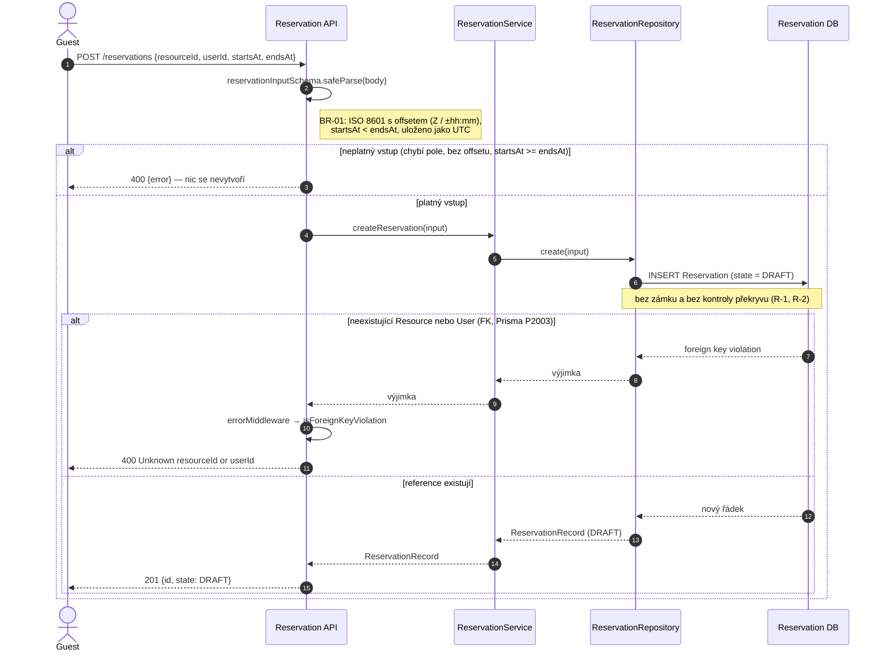
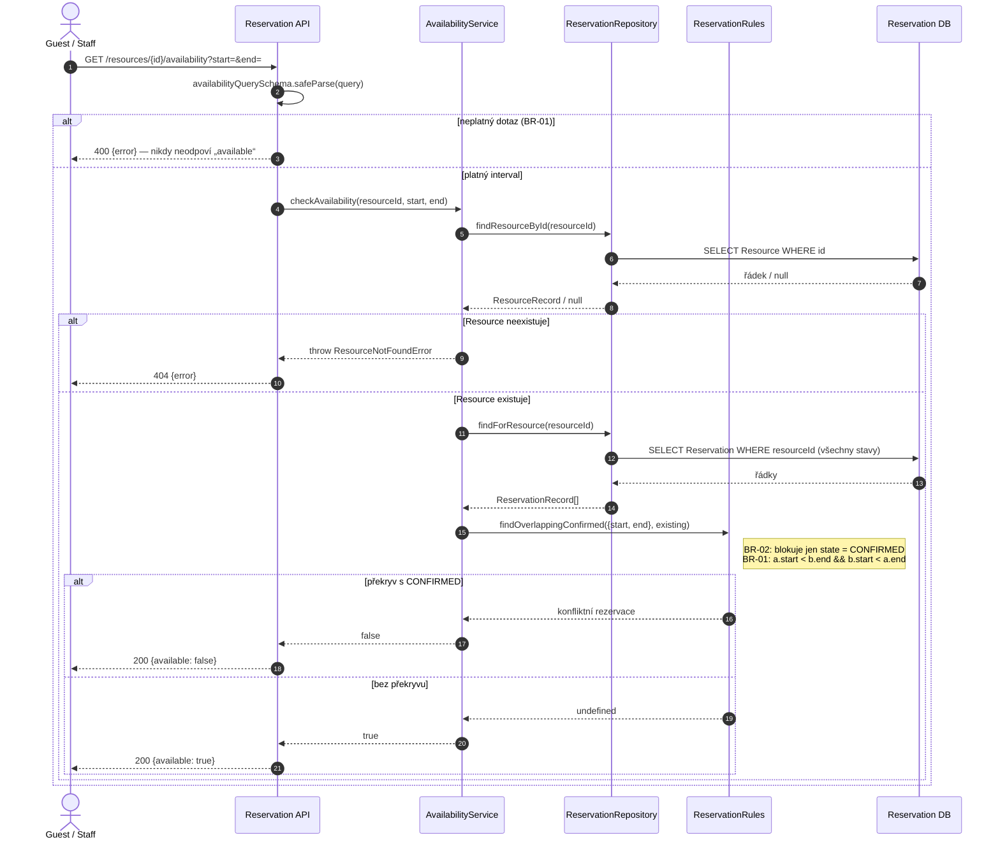
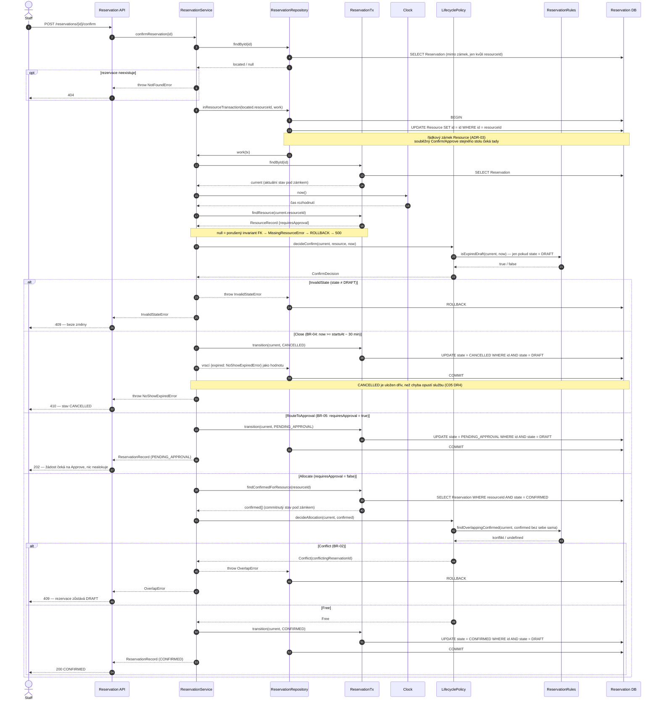
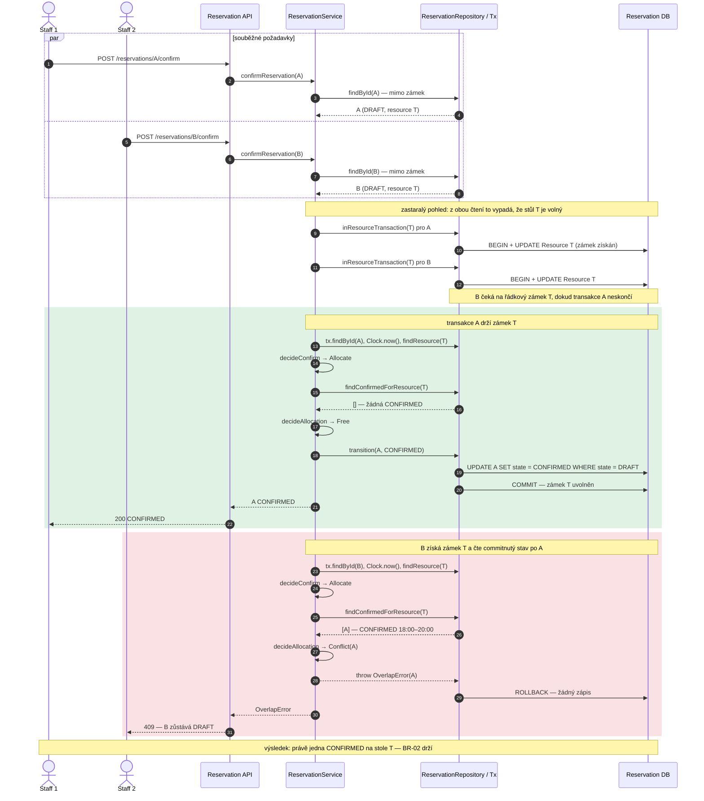

# Sekvenční diagramy — Create, Availability, Confirm a invariant BR-02

Vytvořeno 3. 11. 2026 podle [specifikace](../specification.md) (v0.2 baseline + C07 upřesnění BR-01),
[architektury a DD](../architecture-and-decisions.md) (ADR-03, C05 H1–H3) a aktuálního kódu na `main`
(`ff027e3`). Každá zpráva v diagramu odpovídá skutečnému volání v kódu; názvy účastníků odpovídají
prvkům z C03 G2 a třídám z C05 DD.

| Účastník | Prvek architektury | Kód |
|---|---|---|
| Reservation API | [G2](../architecture-and-decisions.md#g2-to-be-statická-architektura) HTTP vrstva, validace vstupu, mapování chyb | [`src/http/app.ts`](../../src/http/app.ts) |
| ReservationService | Reservation Lifecycle (jediný vlastník přechodů, [ADR-03](../architecture-and-decisions.md#f-adr-03--kde-se-rozhoduje-alokace-br-02-při-souběhu)) | [`src/services/reservationService.ts`](../../src/services/reservationService.ts) |
| AvailabilityService | Availability (read-only OP-02) | [`src/services/availabilityService.ts`](../../src/services/availabilityService.ts) |
| LifecyclePolicy | čisté rozhodnutí přechodu ([C05 N1](../architecture-and-decisions.md#design-elements-and-ownership)) | [`src/domain/lifecyclePolicy.ts`](../../src/domain/lifecyclePolicy.ts) |
| ReservationRules | BR-01 … BR-04 predikáty | [`src/domain/rules.ts`](../../src/domain/rules.ts) |
| Clock | jediný zdroj „now“ ([C05 N2](../architecture-and-decisions.md#design-elements-and-ownership)) | [`src/domain/clock.ts`](../../src/domain/clock.ts) |
| ReservationRepository / ReservationTx | Reservation Persistence (Prisma adaptér portu `ReservationStore`) | [`src/repositories/reservationRepository.ts`](../../src/repositories/reservationRepository.ts) |
| Reservation DB | PostgreSQL 16 (výchozí), SQLite (historický profil) | [`prisma/schema.prisma`](../../prisma/schema.prisma) |

---

## SD-1 — OP-01 Create Reservation (REQ-01)

Create jen zaznamená záměr: vytvoří DRAFT a **nekontroluje překryv** (R-2) ani čas (R-14).
Existenci Resource a User neověřuje služba dotazem, ale integrita DB (cizí klíče), jak říká
hlavní scénář OP-01 („verify references through persistence integrity“).

Postcondition: `[none] → DRAFT`; dostupnost stolu se nemění (DRAFT neblokuje, BR-02).
Testy: V-01.1–V-01.7 (`tests/spec/op01-op02.test.ts`, `tests/http/app.test.ts`).

---

## SD-2 — OP-02 Check Availability (REQ-02)

Čistě čtecí dotaz: neotevírá transakci, nebere zámek, nemění stav a nedetekuje expiraci
(R-16, BR-06). Používá stejnou definici BR-02 (`findOverlappingConfirmed`) jako alokace v Lifecycle.

Výsledek je snímek, ne držení slotu: `available: true` neslibuje, že pozdější Confirm projde.
DRAFT, PENDING_APPROVAL, CANCELLED, REJECTED a EXPIRED (V-02.5, V-02.8, V-02.9, V-05.6) neblokují.

---

## SD-3 — OP-03 Confirm Reservation (REQ-03)

Návrh: [C03 H1](../architecture-and-decisions.md#h1-návrhový-sekvenční-diagram--confirm-reservation) (historický),
[C05 Algorithm / decision logic](../architecture-and-decisions.md#algorithm--decision-logic), [C05 Detailed sequence](../architecture-and-decisions.md#detailed-sequence).

Kompletní tok včetně všech větví rozhodnutí `decideConfirm` (pořadí: stav → BR-04 → BR-05 → BR-02).
Rozhodnutí probíhá výhradně nad stavem načteným **pod zámkem Resource** a čas se čte až po zámku.

Poznámky:

- `transition()` je druhá pojistka: `UPDATE … WHERE id AND state = <očekávaný>`. Pokud neovlivní
  žádný řádek, vyhodí `ReservationConflictError` → rollback → 409 a vítěze nepřepíše.
- HTTP kód 200 vs. 202 volí API podle výsledného stavu (`PENDING_APPROVAL` → 202).
- Chyby mapuje jediné místo, `errorMiddleware` v `app.ts`: `NotFoundError` 404, `InvalidStateError`
  a `OverlapError` 409, `NoShowExpiredError` 410, ostatní 500.
- Approve (OP-05) má stejný tvar; místo `decideConfirm` volá `decideApprove` (BR-06 → EXPIRED + 410),
  BR-05 se znovu nevyhodnocuje. Variantu s konfliktem ukazuje [C05 H3](../architecture-and-decisions.md#detailed-sequence).

Testy: V-03.x, DD-T1…T9 (`tests/services/reservationLifecycle.unit.test.ts`,
`tests/domain/lifecyclePolicy.test.ts`, `tests/services/reservationService.test.ts`).

---

## SD-4 — Business rule / invariant BR-02 při souběhu (REQ-04)

Návrh: [E3 průchod scénářem](../architecture-and-decisions.md#e3-průchod-scénářem--souběžný-confirm-dvou-překrývajících-se-rezervací),
[ADR-03](../architecture-and-decisions.md#f-adr-03--kde-se-rozhoduje-alokace-br-02-při-souběhu), [G4 runtime mapping](../architecture-and-decisions.md#g4-runtime--deployment-mapping).

**Invariant BR-02:** žádný commitnutý stav nesmí obsahovat dvě překrývající se CONFIRMED rezervace
téhož Resource. **REQ-04:** ze souběžných Confirm/Approve na překrývající se intervaly téhož stolu
vznikne nejvýše jedna CONFIRMED; poražený dostane 409 a nic nealokuje.

Scénář V-04R.1: rezervace A a B jsou DRAFT na stejný stůl, intervaly se překrývají
(18:00–20:00), dva pracovníci je potvrzují současně. Obě počáteční čtení ještě vidí
„nic CONFIRMED“ — rozhoduje až čtení pod zámkem.

Kde invariant drží:

| Místo | Co dělá | Proč stačí / nestačí |
|---|---|---|
| Zámek Resource v `inResourceTransaction` | serializuje všechny přechody téhož stolu | rozhodnutí B vidí commit A; bez zámku by oba prošli (PostgreSQL READ COMMITTED) — dokazuje `tests/postgres/lock-mechanism.test.ts` |
| `decideAllocation` + `findOverlappingConfirmed` | jediné rozhodnutí BR-02 (Confirm i Approve) | stejná definice překryvu jako Availability (BR-01 polouzavřené intervaly) |
| guard `WHERE state = očekávaný` v `transition()` | druhá pojistka proti přepsání novějšího stavu | chrání závod na **stejné** rezervaci (V-04R.2), ne překryv dvou různých |

Omezení (ADR-03, riziko R-02): invariant chrání jen zápisy přes Reservation Lifecycle. DB nemá
exclusion constraint, takže přímý SQL zápis nebo `npm run db:import-sqlite` jej může obejít.

Testy: V-04R.1, V-04R.2, V-04R.3, V-04R.6–8 (`tests/services/concurrency.test.ts`),
`tests/postgres/lock-mechanism.test.ts`, zátěž `scripts/postgres-load.ts`.

---

## Kontrola konzistence s předchozí dokumentací (3. 11. 2026)

| ID | Porovnání | Výsledek |
|---|---|---|
| SQ-1 | SD-1 vs. [activity OP-01](activity-create-and-availability.md) | Výsledky sedí (400 / 201 DRAFT, bez overlap). Rozdíl v mechanismu: aktivita kreslí dvě samostatné kontroly „Resource exists? / User exists?“, kód dělá jeden INSERT a obě chyby vrací jako jednu 400 z FK. Specifikace připouští oba pohledy. Aktivita neukazuje C07 pravidlo o offsetu časů (V-01.6). |
| SQ-2 | SD-2 vs. activity OP-02 a OP-02 ve specifikaci | OK: validace → 400, neznámý stůl → 404, jen CONFIRMED blokuje, žádná změna stavu. |
| SQ-3 | SD-3 vs. [activity Confirm v0.2](activity-confirm-cancel.md) a [stavový diagram](state-diagram.md) | OK: pořadí stav → BR-04 → BR-05 → BR-02 a kódy 404/409/410/202/200 sedí. Aktivita nezobrazuje zámek a `MissingResourceError` (500) — záměrně, je to logický pohled. |
| SQ-4 | SD-3 vs. [C03 H1](../architecture-and-decisions.md#h1-návrhový-sekvenční-diagram--confirm-reservation) | **H1 je zastaralý vůči kódu po C05:** volá `confirm(id, now)` místo `confirmReservation(id)` + `Clock.now()` po zámku, Lifecycle volá `isExpiredDraft` přímo místo přes `LifecyclePolicy`, Resource čte až po kontrole lhůty a chybí větve BR-04 (CANCELLED + 410) a BR-05 (PENDING_APPROVAL + 202). H1 je historický návrh C03; aktuální tok popisuje SD-3. |
| SQ-5 | SD-3/SD-4 vs. [C05 H3](../architecture-and-decisions.md#detailed-sequence) | OK: stejné pořadí volání (findById → zámek → findById → Clock → policy → findConfirmed → decideAllocation → rollback). |
| SQ-6 | SD-4 vs. ADR-03 a REQ-04 | OK: serializace podle Resource, poražený dostává `OverlapError` (409), ne ztracený zápis. |
