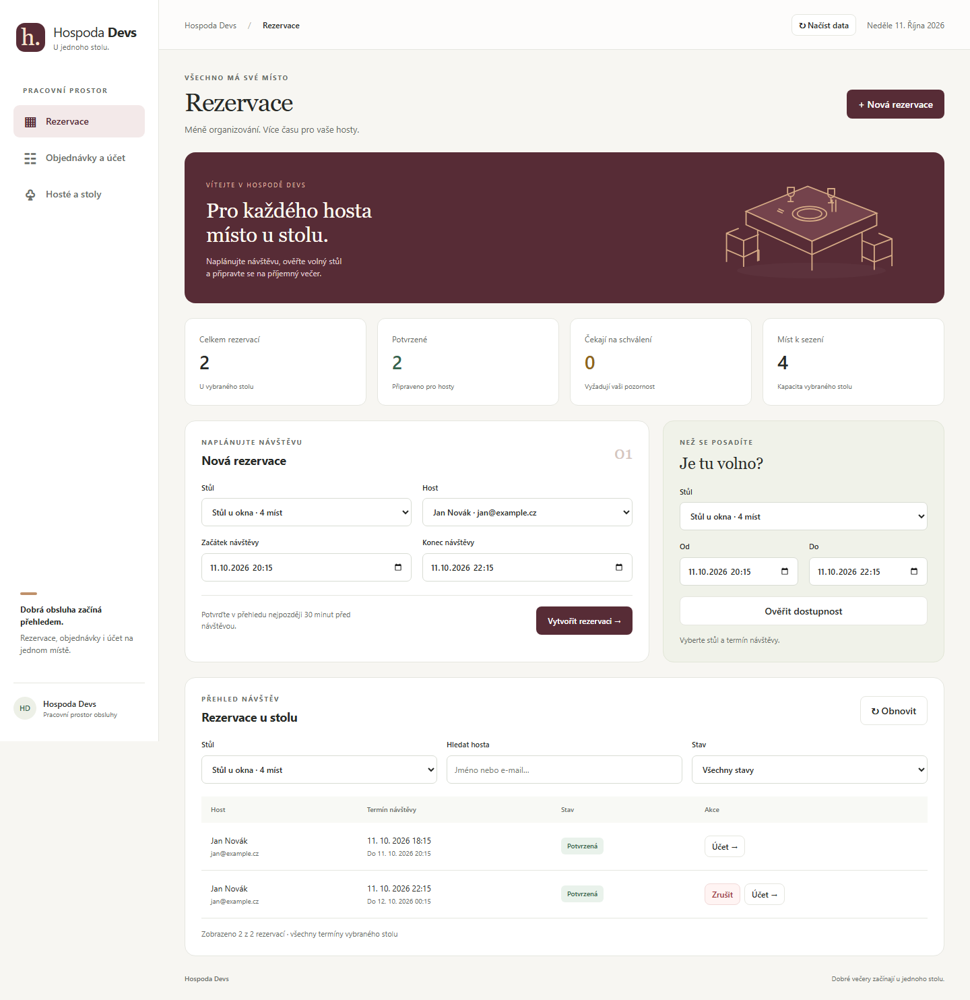
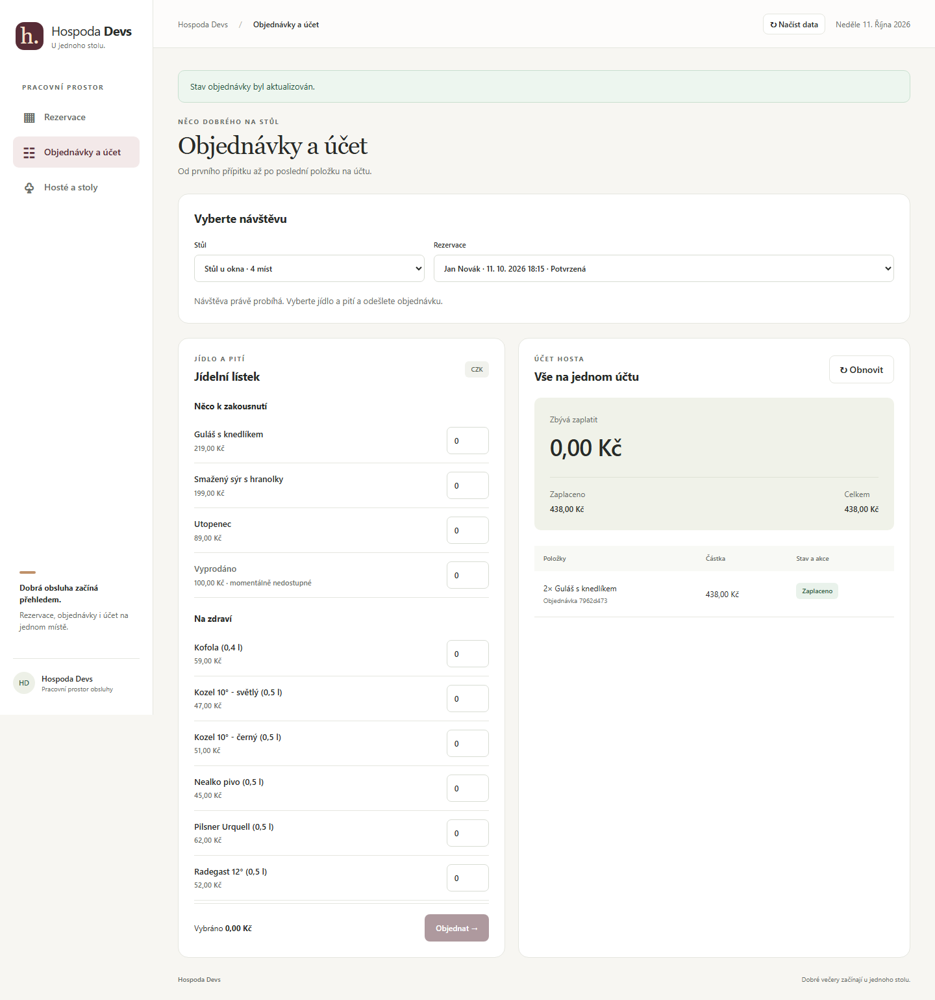
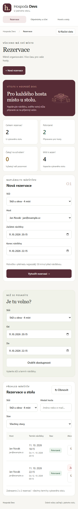

# Frontend — issue #16

## Původní provedení

Express v `src/http/app.ts` podává tři statické soubory z `public/`:
`index.html`, `styles.css` a `app.js`. JavaScript komunikuje přímo se stejným
REST API přes `fetch`. Původní jednostránkové rozhraní sloužilo ručnímu
testování: všechny formuláře byly pod sebou, akce měly anglické názvy,
výsledky se zobrazovaly jako HTTP kód a JSON nebo `alert`. Chyběly rozlišené
prázdné a načítací stavy, hledání a ošetření síťových chyb. Uživatelské hodnoty
se vkládaly přes `innerHTML`.

## Návrh a provedení

Inspirací jsou [OpenTable](https://www.opentable.com/) a [Resy](https://resy.com/),
zejména práce s výběrem termínu a přehlednou rezervací. Rozhraní je přizpůsobené
obsluze jedné hospody a skutečným funkcím tohoto projektu. Používá vlastní
vínovou a krémovou paletu, zelené akcenty, karty, střídmou typografii a vlastní
SVG ilustraci stolu a favicon. Externí fonty, fotografie ani sledovací skripty
se nenačítají.

- **Rezervace:** přehled vybraného stolu, tvorba rezervací, dostupnost,
  vyhledávání podle jména/e-mailu, filtr stavů a akce podle stavu rezervace.
  Čísla v přehledu zahrnují všechny termíny vybraného stolu, nikoliv celou hospodu
  nebo pouze dnešek. Výchozí termín je alespoň hodinu dopředu.
- **Objednávky a účet:** výběr stolu a rezervace, lístek rozdělený na jídlo a pití,
  množství a součet, nedostupné položky, podání objednávky a evidence zaplacení.
  Objednávání je dostupné jen během potvrzené návštěvy; server pravidlo dále
  vynucuje. Účet automaticky reaguje na změnu vybrané rezervace.
- **Hosté a stoly:** samostatné formuláře s popisky a přehled existujících údajů,
  kapacity a požadavku na schválení.

Navigace používá fragmenty `#reservations`, `#orders` a `#manage`, které fungují
i jako přímé odkazy. Na mobilu se přesouvá nad obsah a formuláře se skládají
pod sebe. Široké tabulky lze posouvat uvnitř karty. Popisky polí, popsané stavy,
viditelné zaměření klávesnice, odkaz pro přeskočení navigace a `aria-live`
zlepšují přístupnost. Barevný stav vždy doprovází text.

Uživatelská data se vkládají přes DOM a `textContent`. Chyby sítě i HTTP mají
českou zpětnou vazbu přímo v aplikaci. Tlačítka během požadavku brání opakovanému
odeslání. Verze požadavků zabraňují přepsání aktuálních rezervací nebo účtu
opožděnou odpovědí pro dříve vybraný záznam. **Načíst data** umožňuje nové načtení
i po selhání úvodního spojení. Žádné změny doménových pravidel, API ani databázového
schématu nejsou pro návrh potřebné.

## Ověření

```bash
npm run build
node scripts/check-browser-syntax.mjs
npm test
npx playwright install chromium --only-shell
npm run test:frontend
```

Playwright je pouze vývojová závislost. `scripts/verify-frontend.mjs` používá
novou izolovanou PostgreSQL databázi, migrace, demo menu a skutečný HTTP server.
Databázi ani nastavení vývojového prostředí nemění. Pro probíhající návštěvu
připraví testovací potvrzenou rezervaci přímo v izolované DB; ostatní rezervace,
schvalování, objednávky a změny stavů provádí přes UI.

Ověřuje prázdné stavy, vytváření hostů/stolů, bezpečné vykreslení HTML v názvu,
rezervace a intervaly, potvrzení, kolizi, schválení, zamítnutí, zrušení,
dostupnost, hledání, filtry, součty objednávek, podání a zaplacení, reset účtu,
opožděné odpovědi, chyby spojení a obnovu. Kontroluje šířky 320, 390, 768,
1024 a 1440 px. Výstup je v [reportu prohlížeče](evidence/frontend-verification.json).
Stávajících 95 backendových testů prošlo; stručný záznam je v
[reportu regrese](evidence/frontend-backend-tests.json).

### Rezervace na desktopu



### Objednávky a účet



### Rezervace na mobilu


